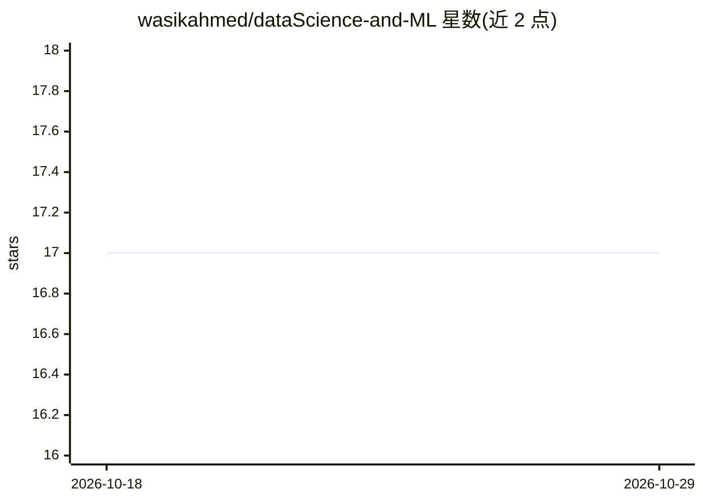

# wasikahmed/dataScience-and-ML

⭐ 17 · Jupyter Notebook · 推送 2026-10-03 · [GitHub](https://github.com/wasikahmed/dataScience-and-ML) · 个人维护

**个人学习笔记仓库：Python 数据与机器学习栈实践 notebook**

个人学习型 notebook 集合，覆盖 Python 数据与机器学习技术栈：NumPy 与 Pandas（基础操作、分组、100 NumPy 练习与 100 pandas 谜题集）、Matplotlib 基本绘图与子图、scikit-learn（线性回归、Framingham 心脏研究数据上的逻辑回归、k 近邻）以及 PyTorch（张量基础与端到端训练流程）。以 Jupyter notebook 形式组织，README 未提供安装命令或运行说明。

## 筛选速览

| 维度 | 判定 | 备注 |
|---|---|---|
| AI 角色 | `ai-knowledge` | 知识聚合/清单类 |
| 许可风险 | `none` | — |
| 部署形态 | `None` |  |
| 模型依赖 | — | README 未给出锁定关系 |
| 硬件要求 | — | 无带数字的原话,不猜 |
| 安装摩擦 | `low` | 无编译、无系统依赖或容器化 |
| 成熟度 | — | 结构信号不足 |

## 能力要点

- NumPy/Pandas 学习 notebook 含 100 NumPy 练习与 100 pandas 谜题集
- scikit-learn 回归与分类实践（含 Framingham 心脏研究数据）
- PyTorch 张量基础与端到端训练流程 notebook

## 适用场景

- 查找 NumPy/Pandas 数据操作的分步示例
- 参考 scikit-learn 回归与分类的基础练习
- 作为机器学习入门的自学练习路线参考

## 场景标签

 · 领域:数据科学/机器学习教育

## 证据(README 行号)

> L3: My notebooks from learning the Python data and machine-learning stack.
> L5: - **NumPy and Pandas:** basics, viewing, manipulating and grouping data, plus the "100 NumPy exercises" and "100 pan

## 星数曲线

2026-10-18 17 → 2026-10-29 17（+0）

---
*卡片 v1 · prompt 1.4 · 生成 2026-10-29 · 置信度 high · 依据 README sha `6cd488f00b0e` · [字段定义](../../DATASET.md)*
