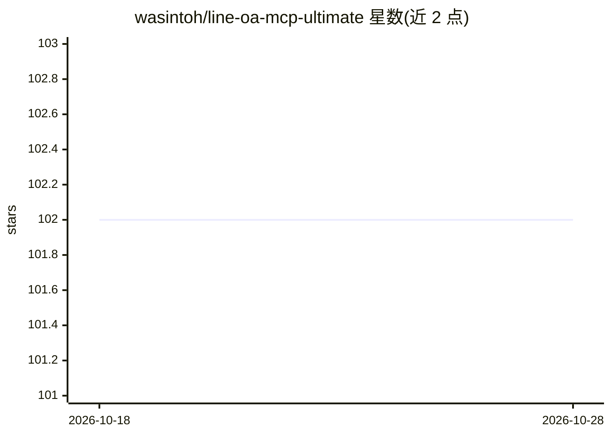

# wasintoh/line-oa-mcp-ultimate

⭐ 102 · TypeScript · MIT · 推送 2026-08-24 · [GitHub](https://github.com/wasintoh/line-oa-mcp-ultimate) · [官网](https://www.npmjs.com/package/line-oa-mcp-ultimate) · 个人维护 · 中文 README

**用自然语言操作 LINE 官方账号的 MCP 服务器（51 工具）**

Model Context Protocol 服务器，让 AI agent 通过自然语言驱动 LINE 官方账号：37 个消息类工具覆盖发送（broadcast/narrowcast 等）、Rich Menu 全生命周期与图像生成、Flex/Rich/Card 消息设计、受众、洞察、原生优惠券、Webhook、多 OA 切换；另有 14 个选启的 LINE Shopping（MyShop）工具管理商品、库存、订单与结算。面向营销人员、代理商与开发者，提供配额预检、静默时段告警与泰文本地化。通过 MCP 配置加入 Claude、Cursor 等 host，npx 运行，需 Node.js 20+ 与 Channel Access Token。

## 筛选速览

| 维度 | 判定 | 备注 |
|---|---|---|
| AI 角色 | `ai-ecosystem` | LLM/agent 周边工具 |
| 许可风险 | `permissive` | MIT |
| 部署形态 | `library` | 以包/库形式分发 |
| 模型依赖 | — | README 未给出锁定关系 |
| 硬件要求 | — | 无带数字的原话,不猜 |
| 安装摩擦 | `low` | 无编译、无系统依赖或容器化 |
| 成熟度 | — | 结构信号不足 |

## 能力要点

- 37 消息工具 + 14 LINE Shopping（MyShop）工具 + 4 资源 + 8 引导式提示词
- v2.2 Rich Message 零托管：附图即自动缩放、托管并在成功前验证
- 多 OA 管理：单配置文件注册所有客户账号，运行时切换与并行 fan-out
- 配额预检、22:00–08:00 静默时段告警与 dry_run 成本估算

## 适用场景

- 在 AI 助手里用一句话向指定受众群发营销消息
- 代理商在一个配置文件里管理并切换多个客户的 LINE 官方账号
- 用自然语言运营 LINE Shopping 店铺：商品、库存、订单与发货
- 生成并预览 Rich Menu 图片后一键部署

## 场景标签

 · 领域:即时通讯营销/电商自动化

## 证据(README 行号)

> L26: `line-oa-mcp-ultimate` is a Model Context Protocol server that lets AI agents drive your LINE Official Account thro
> L30: It works with **Claude Cowork, Claude Code, Cursor, Codex, ChatGPT desktop, OpenClaw, Hermes**, or any MCP-compatib

## 星数曲线

2026-10-18 102 → 2026-10-28 102（+0）

---
*卡片 v1 · prompt 1.4 · 生成 2026-10-23 · 置信度 high · 依据 README sha `aa8c49e51913` · [字段定义](../../DATASET.md)*
