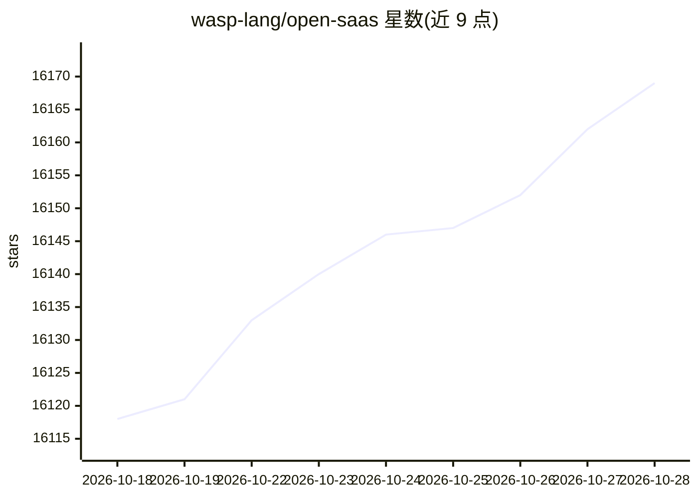

# wasp-lang/open-saas

⭐ 16,169 · MDX · MIT · 推送 2026-10-27 · [GitHub](https://github.com/wasp-lang/open-saas) · [官网](https://opensaas.sh) · 组织维护

**面向开发者的开源 JS 全栈 SaaS 起始模板**

基于 Wasp 框架（React + NodeJS + Prisma）的 SaaS 应用模板，内置邮件+社交登录认证、邮件发送、后台定时任务/队列、落地页、Stripe/Polar.sh/Lemon Squeezy 支付、ShadCN UI、AWS S3 文件上传、文档与博客（Astro Starlight）以及 Plausible/Google Analytics 统计。模板提供针对 Claude Code、Cursor 等 AI 编码工具的插件、Skills 与规则文件，并含 OpenAI API function calling 示例；可通过 CLI 一条命令部署到 Railway 或 Fly.io。安装依赖 npm 全局安装 Wasp CLI。

## 筛选速览

| 维度 | 判定 | 备注 |
|---|---|---|
| AI 角色 | `ai-enhanced` | 去掉 AI 部分产品仍成立 |
| 许可风险 | `permissive` | MIT |
| 部署形态 | `library` | 以包/库形式分发 |
| 模型依赖 | — | README 未给出锁定关系 |
| 硬件要求 | — | 无带数字的原话,不猜 |
| 安装摩擦 | `low` | 无编译、无系统依赖或容器化 |
| 成熟度 | — | 结构信号不足 |

## 动量与使用信号

- 维护:`active` — 距上次 push 1.7 天,年发版 8,54 位贡献者
- 涨星:近 1 天 **+11**(自 20261016 起算)
- 安装:npm 包 `@wasp.sh/wasp-cli` 月下载 22,689
- 平台:WINDOWS / MACOS / LINUX · 协议:OPENAI-API

## 能力要点

- 内置认证（Email、Google、GitHub、Slack、MS）、支付、邮件、后台任务、S3 上传等 SaaS 常用模块
- 提供面向 Claude Code/Cursor 等 AI 编码工具的插件、Skills 与规则文件
- 含 OpenAI API function calling 示例
- CLI 一条命令部署到 Railway 或 Fly.io

## 适用场景

- 启动一个新的全栈 SaaS 项目而无需从零搭建基础设施
- 为项目快速接入支付、订阅与文件上传功能
- 在 AI 编码工具辅助下基于模板开发 SaaS 应用

## 场景标签

 · 领域:软件开发/应用脚手架

## 证据(README 行号)

> L28: - 🐝 Wasp - a full-stack React, NodeJS, Prisma framework with superpowers
> L32: - 🤖 AI-Ready - Custom Plugins, Skills, & Rules for AI-assisted coding with Claude Code, Cursor, or your favorite AI
> L19: 4. ready to work with your favorite AI coding tool or agent (Claude Code, Cursor, Codex, OpenCode, etc.)

## 星数曲线

2026-10-18 16,118 → 2026-10-28 16,169（+51）

---
*卡片 v1 · prompt 1.4 · 生成 2026-10-18 · 置信度 high · 依据 README sha `b360a63ea5e9` · [字段定义](../../DATASET.md)*
