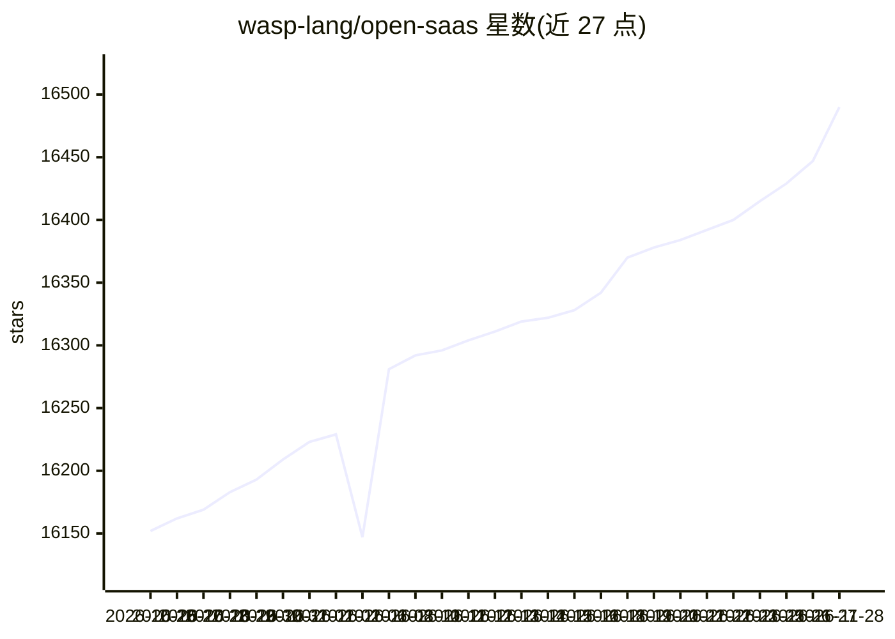

# wasp-lang/open-saas

⭐ 16,490 · MDX · MIT · 推送 2026-11-25 · [GitHub](https://github.com/wasp-lang/open-saas) · [官网](https://opensaas.sh) · 组织维护

**免费开源 JS 技术栈 SaaS 启动模板，内置 AI 编码配套**

基于 Wasp 框架（React+NodeJS+Prisma）的开源 SaaS 模板，开箱提供邮箱与社交登录认证、SendGrid/MailGun/SMTP 邮件发送、后台定时任务与队列、落地页与文档博客（Astro Starlight）、Stripe/Polar.sh/Lemon Squeezy 支付、ShadCN UI、AWS S3 文件上传及 Plausible/Google Analytics 集成。AI 相关部分：面向 Claude Code、Cursor 等编码工具定制的插件、Skills 与规则，以及含 function calling 的 OpenAI API 示例。通过 wasp-cli 安装，支持 Railway/Fly.io 一键部署。

## 筛选速览

| 维度 | 判定 | 备注 |
|---|---|---|
| AI 角色 | `ai-enhanced` | 去掉 AI 部分产品仍成立 |
| 许可风险 | `permissive` | MIT |
| 部署形态 | `library` | 以包/库形式分发 |
| 模型依赖 | — | README 未给出锁定关系 |
| 硬件要求 | — | 无带数字的原话,不猜 |
| 安装摩擦 | `low` | 无编译、无系统依赖或容器化 |
| 成熟度 | — | 结构信号不足 |

## 动量与使用信号

- 维护:`active` — 距上次 push 1.7 天,年发版 8,54 位贡献者
- 涨星:近 1 天 **+11**(自 20261016 起算)
- 安装:npm 包 `@wasp.sh/wasp-cli` 月下载 22,689
- 平台:WINDOWS / MACOS / LINUX · 协议:OPENAI-API

## 能力要点

- 认证、支付、邮件、文件上传、后台任务等 SaaS 常用功能开箱即用
- 内置 OpenAI API function calling 示例
- 为 Claude Code/Cursor 等 AI 编码工具提供定制插件、Skills 与规则
- 一条命令部署到 Railway 或 Fly.io

## 适用场景

- 快速搭建一个带支付与认证的 SaaS 产品原型
- 基于模板接入 OpenAI function calling 开发 AI 功能
- 用 AI 编码助手基于该模板进行开发

## 场景标签

 · 领域:软件开发/应用模板

## 证据(README 行号)

> L31: - 🐝 Wasp - a full-stack React, NodeJS, Prisma framework with superpowers
> L35: - 🤖 AI-Ready - Custom Plugins, Skills, & Rules for AI-assisted coding with Claude Code, Cursor, or your favorite AI

## 星数曲线

2026-10-26 16,152 → 2026-11-28 16,490（+338）

---
*卡片 v1 · prompt 1.4 · 生成 2026-11-22 · 置信度 high · 依据 README sha `e87228bf1bbb` · [字段定义](../../DATASET.md)*
