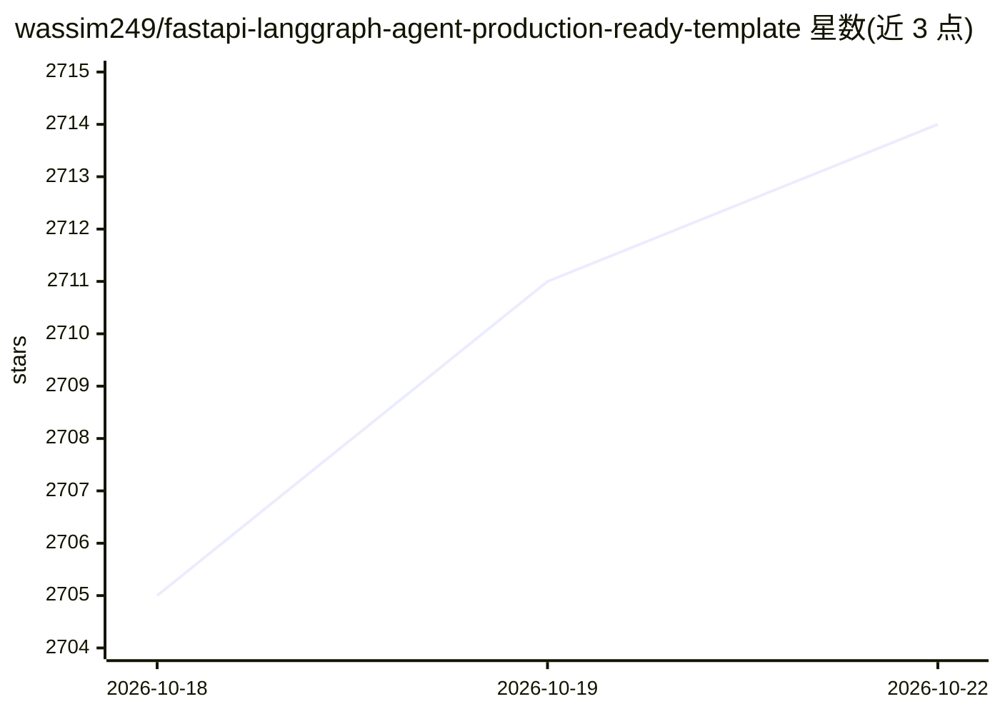

# wassim249/fastapi-langgraph-agent-production-ready-template

⭐ 2,718 · Python · MIT · 推送 2026-10-17 · [GitHub](https://github.com/wassim249/fastapi-langgraph-agent-production-ready-template) · 个人维护

**面向 AI 工程师的 FastAPI + LangGraph Agent 后端生产级模板**

基于 FastAPI 与 LangGraph 的 AI agent 后端模板，内置状态化对话与 checkpointing、基于 mem0 + pgvector 的按用户长期记忆、工具调用、带循环模型回退与重试预算的 LLM 服务、Langfuse 追踪与 Prometheus + Grafana 监控、JWT 认证与 slowapi 限流、Alembic 迁移等组件。LLM 接入通过 LLMRegistry（init_chat_model）支持任意 LangChain 兼容 provider，OpenAI 兼容端点可直接替换 BASE_URL 使用。文档标注 Docker 为推荐但非必需，README 含 Atlas Cloud 推广章节，这占较大篇幅。

## 筛选速览

| 维度 | 判定 | 备注 |
|---|---|---|
| AI 角色 | `ai-ecosystem` | LLM/agent 周边工具 |
| 许可风险 | `permissive` | MIT |
| 部署形态 | `None` |  |
| 模型依赖 | local-ok | 支持本地模型 |
| 硬件要求 | — | 无带数字的原话,不猜 |
| 安装摩擦 | `medium` | 含编译或系统依赖之一 |
| 成熟度 | — | 结构信号不足 |

## 能力要点

- LangGraph 状态化 agent，支持 checkpointing、工具调用与 human-in-the-loop
- mem0 + pgvector 自托管长期记忆，按用户语义检索
- LLM 服务带循环模型回退、指数退避重试与总超时预算
- Langfuse 追踪、Prometheus + Grafana、结构化日志、JWT 认证与限流

## 适用场景

- 快速搭建带记忆与观测的生产级 AI agent 后端
- 需要认证、限流、迁移等生产组件的 agent 服务开发
- 多模型回退配置下接入不同 LLM provider

## 场景标签

`Agent 框架` `Agent 记忆` · 领域:Agent 开发

## 证据(README 行号)

> L1: # FastAPI LangGraph Agent Template
> L3: A production-ready template for building AI agent backends with FastAPI and LangGraph. Handles the hard parts — stat
> L142: **How does this differ from a basic LangGraph setup?**

## 星数曲线

2026-10-18 2,705 → 2026-10-22 2,714（+9）

---
*卡片 v1 · prompt 1.4 · 生成 2026-10-21 · 置信度 high · 依据 README sha `9881d3fff7f9` · [字段定义](../../DATASET.md)*
