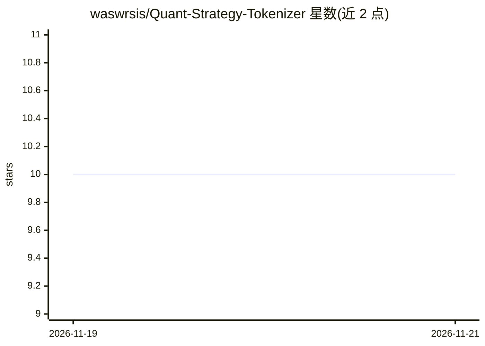

# waswrsis/Quant-Strategy-Tokenizer

⭐ 10 · Python · MIT · 推送 2026-07-05 · [GitHub](https://github.com/waswrsis/Quant-Strategy-Tokenizer) · 个人维护

**把量化策略拆解为可校验、可哈希的 GKR 记录供 agent 接手**

已归档的研究原型，提供 Python 包与 CLI：将策略意图转成类型化的 .gkr.yaml Graph Kernel Records，可执行校验、规范化、图/参数/实例哈希与 token 治理测试；含 12 个公开策略示例、部分 Qlib workflow YAML 导入器、agent prompt 包与交接文档。明确边界：不做实盘、回测、经纪商/交易所接入、模型训练或推理。通过 pip 可编辑安装运行。

## 筛选速览

| 维度 | 判定 | 备注 |
|---|---|---|
| AI 角色 | `ai-ecosystem` | LLM/agent 周边工具 |
| 许可风险 | `permissive` | MIT |
| 部署形态 | `library` | 以包/库形式分发 |
| 模型依赖 | — | README 未给出锁定关系 |
| 硬件要求 | — | 无带数字的原话,不猜 |
| 安装摩擦 | `low` | 无编译、无系统依赖或容器化 |
| 成熟度 | — | 结构信号不足 |

## 能力要点

- 类型化 .gkr.yaml 策略记录：校验/规范化/哈希/一致性测试
- 确定性 canonical JSON 与图、参数、实例哈希
- Qlib 部分工作流 YAML 导入器（仅记录层证据）
- 面向 agent 的 prompt 包、接管提示与二次开发指南

## 适用场景

- 把量化策略表述为可哈希审计的标准化记录
- 为 agent 或下游系统提供可校验的策略交接文件
- 部分导入 Qlib workflow 配置用于覆盖分析

## 场景标签

`金融量化` · 领域:学习与行业

## 证据(README 行号)

> L7: handed off to agents or downstream systems.
> L66: - **Agent layer:** active prompt pack, takeover prompt, playbook, usage guide,
> L23: - active agent prompt pack and handoff docs

## 星数曲线

2026-11-19 10 → 2026-11-21 10（+0）

---
*卡片 v1 · prompt 1.4 · 生成 2026-11-19 · 置信度 high · 依据 README sha `e7b64b73503c` · [字段定义](../../DATASET.md)*
