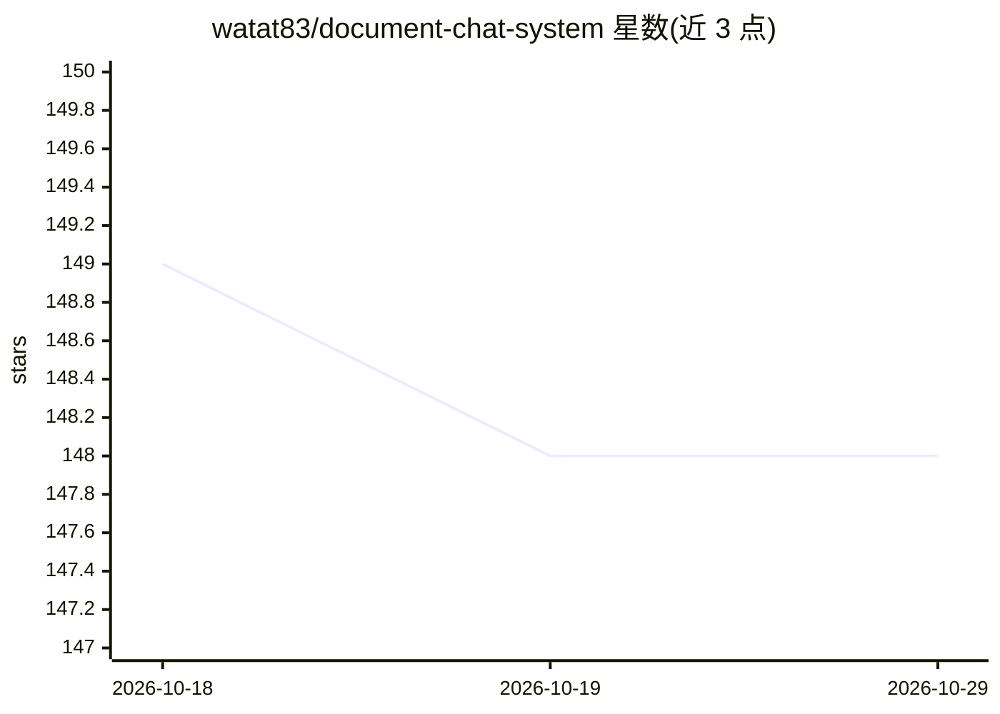

# watat83/document-chat-system

⭐ 148 · TypeScript · MIT · 推送 2026-10-13 · [GitHub](https://github.com/watat83/document-chat-system) · [官网](https://document-chat-system.vercel.app) · 个人维护

**自部署的文档 AI 对话平台：上传文档做 RAG 问答**

基于 Next.js 15/React 19/TypeScript/Prisma 的全栈 RAG 文档对话 Web 应用：上传 PDF、DOCX、TXT、图片等格式后自动提取文本、生成向量嵌入并索引（Pinecone 或 pgvector），用户以自然语言就文档内容问答，回答附来源引用并支持流式输出。接入 OpenRouter（100+ 模型）、OpenAI、Anthropic、ImageRouter 等 AI 提供商，默认 gpt-4o-mini。含多租户组织隔离、Clerk 认证、AES-256 加密、可选 Stripe 计费与 Docling 文档处理；通过 git clone + npm 安装，可 Docker 或 Vercel 部署。

## 筛选速览

| 维度 | 判定 | 备注 |
|---|---|---|
| AI 角色 | `ai-native` | 本体是模型或模型工具 |
| 许可风险 | `permissive` | MIT |
| 部署形态 | `self-host` | docker 或自建部署 |
| 模型依赖 | locked-api |  |
| 硬件要求 | — | 无带数字的原话,不猜 |
| 安装摩擦 | `low` | 无编译、无系统依赖或容器化 |
| 成熟度 | — | 结构信号不足 |

## 能力要点

- RAG 问答附来源引用，支持流式输出与混合检索（语义+关键词）
- 多 AI 提供商接入：OpenRouter（100+ 模型）、OpenAI、Anthropic、ImageRouter
- 多格式文档处理：PDF/DOCX/TXT/图片 OCR，可选 IBM Docling 增强
- 多租户隔离、AES-256 加密、Clerk 认证与可选 Stripe 计费

## 适用场景

- 搭建团队内部文档知识库并就内容问答
- 上传合同、手册等文件快速检索与分析
- 作为白标文档管理 SaaS 对外提供服务

## 场景标签

`文档问答` · 领域:知识与检索

## 证据(README 行号)

> L11: **Transform PDFs & documents into intelligent AI conversations. Production-ready RAG (Retrieval Augmented Generatio
> L36: **Document Chat System** is a full-stack, production-ready application that combines intelligent document managemen
> L132: - **Multiple AI Providers**:

## 星数曲线

2026-10-18 149 → 2026-10-29 148（-1）

---
*卡片 v1 · prompt 1.4 · 生成 2026-10-22 · 置信度 high · 依据 README sha `64e9117a30c6` · [字段定义](../../DATASET.md)*
