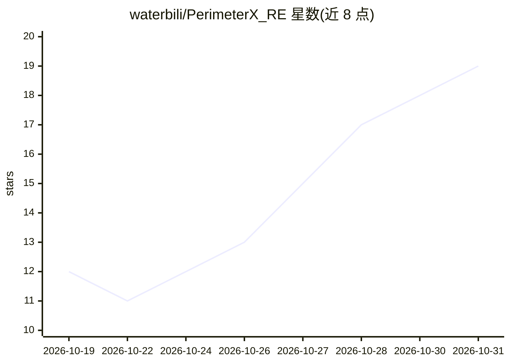

# waterbili/PerimeterX_RE

⭐ 19 · JavaScript · NOASSERTION · 推送 2026-06-19 · [GitHub](https://github.com/waterbili/PerimeterX_RE) · 个人维护 · 中文 README

**PerimeterX 反爬 SDK 的纯算法逆向重建，生成 _px3/_px2 cookie**

面向安全研究者的 PerimeterX（HUMAN Security）反爬 SDK 逆向工程成果：不依赖浏览器或自动化框架，以 Node.js 纯算法重建 sensor payload 加密链（XOR/base64/interleave、HMAC-MD5 签名）与 collector POST 流程，输出有效 _pxN cookie。项目在 5 个站点上 10/10 验证，按 lenient/strict/strict+ 三档部署差异文档化，另附含 7 份参考、11 个 playbook、17 个 CLI 工具的 AI 逆向技能包。限制：绑定锁定 SDK 版本，strict+ 站点需真实 Chrome TLS 与住宅 IP，press-challenge 路径为浏览器 userscript。仅供研究与教育用途。

## 筛选速览

| 维度 | 判定 | 备注 |
|---|---|---|
| AI 角色 | `ai-enhanced` | 去掉 AI 部分产品仍成立 |
| 许可风险 | `none` | NOASSERTION |
| 部署形态 | `library` | 以包/库形式分发 |
| 模型依赖 | — | README 未给出锁定关系 |
| 硬件要求 | — | 无带数字的原话,不猜 |
| 安装摩擦 | `low` | 无编译、无系统依赖或容器化 |
| 成熟度 | — | 结构信号不足 |

## 能力要点

- 纯算法重建 _px3/_px2 cookie 链，无浏览器/自动化框架
- 9 个可复用加密/编码原语（HMAC-MD5、OB 解码、SID 隐写等）
- 5 个站点 10/10 验证，lenient/strict/strict+ 三档部署方法论
- AI 逆向技能包：7 份参考、11 个 playbook、17 个 CLI 工具、23 个 gotcha

## 适用场景

- 研究 PerimeterX 反爬协议与 sensor payload 加密机制
- 为自己的站点做安全审计时理解 PX 防护层级
- 作为 SDK 版本升级后重新逆向的方法论参考

## 场景标签

`网络安全` · 领域:学习与行业

## 证据(README 行号)

> L76: revers/        9 algorithm modules (require()-able)         skill/      AI reverse-engineering skill
> L87: |`skill/AI_re/`|The reverse-engineering skill: 7 references, 11 playbooks, 17 CLI tools, 23 gotchas|

## 星数曲线

2026-10-19 12 → 2026-10-31 19（+7）

---
*卡片 v1 · prompt 1.4 · 生成 2026-10-29 · 置信度 mid · 依据 README sha `78e464e897de` · [字段定义](../../DATASET.md)*
