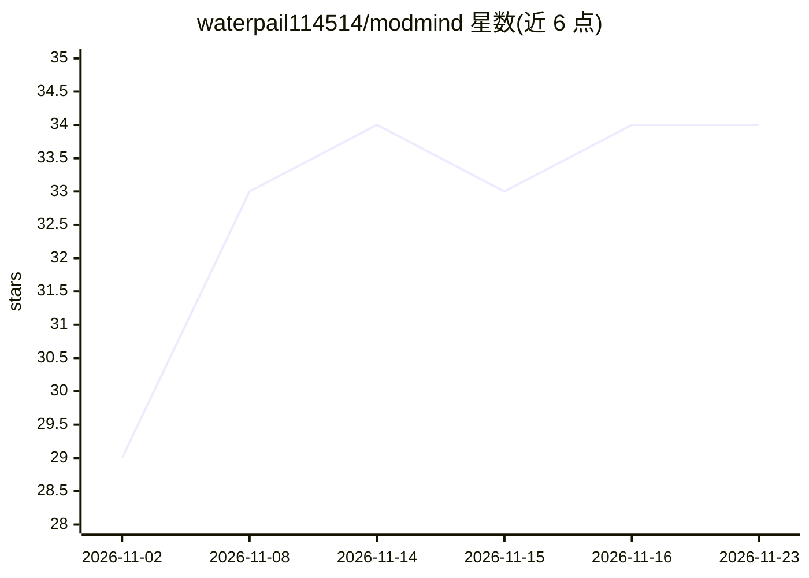

# waterpail114514/modmind

⭐ 34 · TypeScript · AGPL-3.0 · 推送 2026-11-05 · [GitHub](https://github.com/waterpail114514/modmind) · [官网](https://ether-studio.top/) · 个人维护 · 中文 README

**面向 Minecraft 创作者的 AI 辅助桌面创作工作台**

Electron 桌面应用，为 Minecraft 模组、整合包、资源创作者提供集中工作区：灵感台讨论方案、AI 开发工作台（接入 Codex）协助写代码与处理依赖、图像/模型编辑（MiniPaint、Blockbench）、整合包导入（Modrinth/CurseForge）、构建与真实游戏测试（Minecraft Mod MCP）。支持 Fabric/Forge/Paper/网易等多类项目。当前 2.0 为预览版，仅提供 Windows x64 安装包；模型服务为官网付费项，开源许可证不含额度。

## 筛选速览

| 维度 | 判定 | 备注 |
|---|---|---|
| AI 角色 | `ai-enhanced` | 去掉 AI 部分产品仍成立 |
| 许可风险 | `viral` | AGPL-3.0 |
| 部署形态 | `desktop` | 安装包/桌面程序 |
| 模型依赖 | — | README 未给出锁定关系 |
| 硬件要求 | — | 无带数字的原话,不猜 |
| 安装摩擦 | `low` | 无编译、无系统依赖或容器化 |
| 成熟度 | `idea` | |

## 能力要点

- AI 开发工作台接入 Codex，处理文件与文档附件任务
- 真实游戏交互测试：隔离客户端截图与玩家操作（Minecraft Mod MCP）
- 物品与装备编辑器覆盖 Fabric/Quilt/Forge/NeoForge 多版本生成
- 整合包导入（Modrinth/CurseForge）与 FTB Quests/Patchouli 内容管理

## 适用场景

- 在统一工作区内开发 Fabric/Forge 等 Java 模组
- 借助 AI 协助编写代码、制作贴图与处理依赖
- 导入并管理 Modrinth/CurseForge 整合包
- 构建后进行客户端/服务端与真实玩家操作测试

## 场景标签

`编码 Agent` `AI 助手` · 领域:编码与开发

## 证据(README 行号)

> L11: ModMind 是面向 Minecraft 创作者的桌面工作台。你可以先在灵感台整理想法，再让 AI 协助编写代码、制作资源、处理依赖，并在项目中构建和测试。编辑器、对话、图片、模型、整合包和服务端工具都集中在同一个工作区。
> L5: AI 辅助开发 · 模组与整合包 · 资源创作 · 游戏测试

## 星数曲线

2026-11-02 29 → 2026-11-23 34（+5）

---
*卡片 v1 · prompt 1.4 · 生成 2026-11-18 · 置信度 high · 依据 README sha `21c83f70674d` · [字段定义](../../DATASET.md)*
