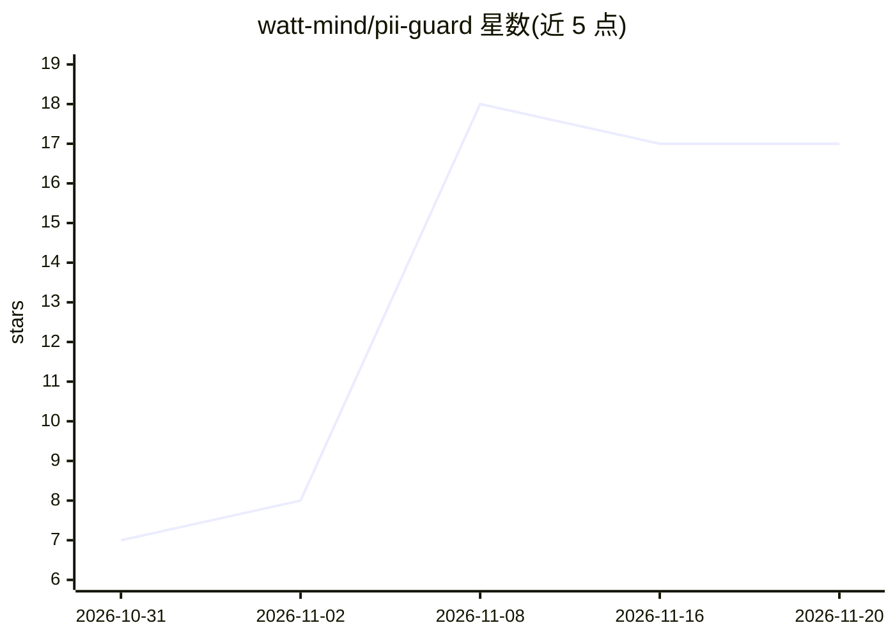

# watt-mind/pii-guard

⭐ 17 · Python · Apache-2.0 · 推送 2026-11-19 · [GitHub](https://github.com/watt-mind/pii-guard) · [官网](https://guard.watt-mind.com) · 组织维护

**AI agent 隐私网关：将个人数据替换为可逆占位符后再发给 LLM**

OpenAI 兼容的隐私网关：请求经网关时用规则加本地 NER（XLM-RoBERTa base，蒸馏自 Muse Glimmer 30B）检测文本、工具调用与图像中的人名、地址、ID 与人脸，替换为可逆占位符后转发给 LLM 提供方，回答流式还原真实值；映射不离开本机。默认快速模式在 CPU 上运行 NER（每条约 43 ms），图像文字与面部检测走 Meta 模型 API，也可自托管。README 标明为假名化而非匿名化或合规保证，并以 990 篇虚构文档对比 Presidio、LLM Guard 等工具。支持 OpenCode、Codex、Claude Code 等编码 agent 接入。

## 筛选速览

| 维度 | 判定 | 备注 |
|---|---|---|
| AI 角色 | `ai-ecosystem` | LLM/agent 周边工具 |
| 许可风险 | `permissive` | Apache-2.0 |
| 部署形态 | `library` | 以包/库形式分发 |
| 模型依赖 | — | README 未给出锁定关系 |
| 硬件要求 | `cpu-ok` | |
| 安装摩擦 | `medium` | 含编译或系统依赖之一 |
| 成熟度 | — | 结构信号不足 |

## 能力要点

- 规则+本地 NER（XLM-RoBERTa）在 CPU 上约 43 ms/条完成检测
- OpenAI Chat Completions/Responses 兼容网关，改一个 base URL 即接入
- 掩码消息、工具定义、工具调用参数与结果、图像，流式逐块还原占位符
- 映射（占位符→原值）不离开本机，无法掩码时 fail closed

## 适用场景

- 让 AI agent 调用外部 LLM 前拦截个人数据，避免明文出网
- 编码 agent（OpenCode/Codex/Claude Code 等）经本地网关使用模型
- 离线/CI 场景用纯规则模式处理结构化数据

## 场景标签

`模型网关` · 领域:Agent 开发

## 证据(README 行号)

> L23: - **What it does.** An OpenAI-compatible gateway for AI agents. Change one base URL, and the names, addresses, IDs 
> L139:  How it works: your app or agent sends a request to PII Guard, which runs on your side. On the way out PII Guard d
> L141: The gateway speaks the OpenAI Chat Completions and Responses APIs. It masks messages, **tool

## 星数曲线

2026-10-31 7 → 2026-11-20 17（+10）

---
*卡片 v1 · prompt 1.4 · 生成 2026-11-18 · 置信度 high · 依据 README sha `700907a5b4f6` · [字段定义](../../DATASET.md)*
