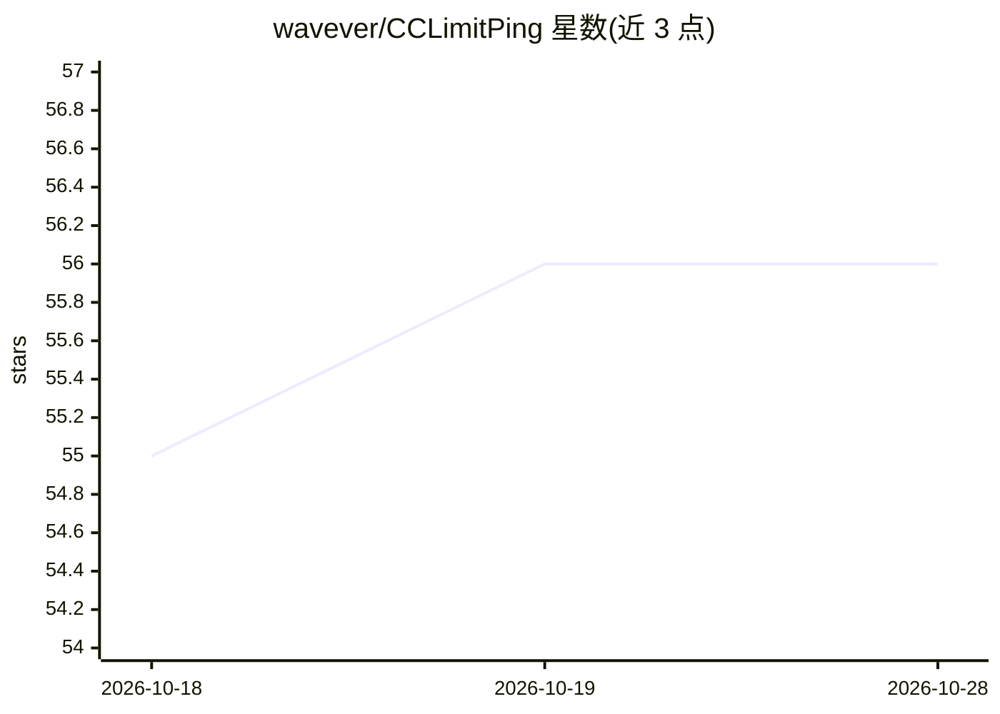

# wavever/CCLimitPing

⭐ 57 · Go · MIT · 推送 2026-10-23 · [GitHub](https://github.com/wavever/CCLimitPing) · 个人维护 · 中文 README

**CLI 工具：在 Claude Code/Codex 5h 限额窗口重置瞬间自动触发新窗口**

Go 编写的单一自包含二进制 CLI（别名 lmp），面向 Claude Code 与 Codex 订阅用户。它通过官方 CLI 的零配额 usage 端点读取 5 小时/每周限额用量与重置倒计时，在窗口安全重置后立即经官方 CLI（claude 交互会话 / codex exec --ephemeral）发送极小请求触发新窗口，使窗口背靠背不留空档。提供一次性 ping、前台 watch、后台 bg watcher 三种运行方式，另支持任务自动续跑（continue）、重置额度赎回、token/成本统计、CLI hooks 检测活动会话避免打断。复用官方 CLI 已登录凭据，无独立登录。

## 筛选速览

| 维度 | 判定 | 备注 |
|---|---|---|
| AI 角色 | `ai-ecosystem` | LLM/agent 周边工具 |
| 许可风险 | `permissive` | MIT |
| 部署形态 | `desktop` | 安装包/桌面程序 |
| 模型依赖 | — | README 未给出锁定关系 |
| 硬件要求 | — | 无带数字的原话,不猜 |
| 安装摩擦 | `low` | 无编译、无系统依赖或容器化 |
| 成熟度 | — | 结构信号不足 |

## 能力要点

- 经零配额 usage 端点读取 5h/每周用量与重置倒计时
- 窗口重置后经官方 CLI 触发新窗口，支持 ping/watch/后台 bg 三种模式
- CLI hooks 检测活动会话，避免 ping 打断正在进行的会话
- continue 自动续跑挂起任务、redeem 消耗将过期的重置额度

## 适用场景

- 让 Claude Code/Codex 订阅的 5h 限额窗口背靠背衔接，不浪费空档
- 查看 5h/每周用量百分比与重置倒计时及折算 API 成本
- 过夜任务在限额恢复瞬间自动继续执行

## 场景标签

 · 领域:AI 开发者工具/CLI

## 证据(README 行号)

> L13: Start the next **Claude Code** or **Codex** rate-limit window the moment the
> L21: `limitping` watches the reset time and sends one tiny request through the
> L22: official provider CLI right after rollover. Run it once, keep `watch` in the

## 星数曲线

2026-10-18 55 → 2026-10-28 56（+1）

---
*卡片 v1 · prompt 1.4 · 生成 2026-10-24 · 置信度 high · 依据 README sha `8abc9c87f1f8` · [字段定义](../../DATASET.md)*
