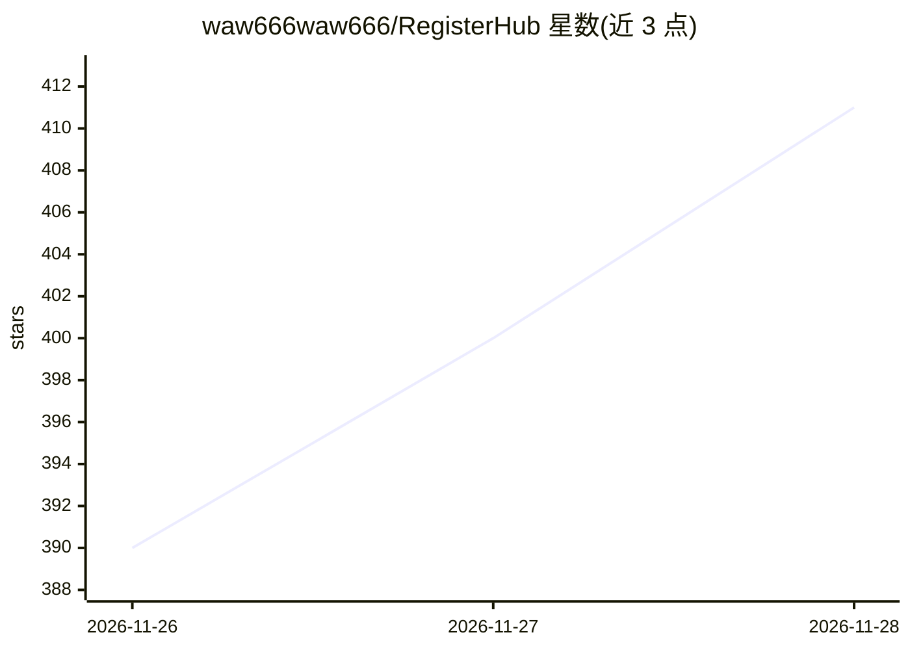

# waw666waw666/RegisterHub

⭐ 411 · Python · Apache-2.0 · 推送 2026-11-27 · [GitHub](https://github.com/waw666waw666/RegisterHub) · [官网](https://waw666waw666.github.io/registerhub-demo/) · 个人维护 · 中文 README

**面向开发者的账号自动化注册框架，内置自主写适配器的 AI Agent**

以纯 Python 标准库驱动的账号注册自动化框架，提供零 Docker、零 Node.js 的本地 Web 工作台（127.0.0.1:18886）与 CLI 两类入口。核心机制包括：内置流式 AI Agent（支持 OpenAI Chat / Anthropic Messages / OpenAI Responses 三协议）通过 16 项工具探测目标站、生成并试跑站点适配器；内置 SQLite 加密邮箱池（Outlook OAuth2 / iCloud / IMAP）与代理池；OpenCV 滑块求解与 Chrome/CDP 桥接。主仓库不含商业站点适配器，5 个实战派生仓独立发布。采用 Open-Core 模式，并发调度、定时补货等能力在商业版 AutoRegister Pro 中。

## 筛选速览

| 维度 | 判定 | 备注 |
|---|---|---|
| AI 角色 | `ai-enhanced` | 去掉 AI 部分产品仍成立 |
| 许可风险 | `permissive` | Apache-2.0 |
| 部署形态 | `None` |  |
| 模型依赖 | — | README 未给出锁定关系 |
| 硬件要求 | — | 无带数字的原话,不猜 |
| 安装摩擦 | `low` | 无编译、无系统依赖或容器化 |
| 成熟度 | — | 结构信号不足 |

## 能力要点

- 内置流式 AI Agent：16 项工具自动探测、写适配器、试跑与自愈闭环
- 内置加密邮箱池（Outlook OAuth2/iCloud/IMAP）与代理池（HTTP/SOCKS5/住宅网关）
- 零 Docker、零 Node.js，纯 Python 标准库驱动，双击脚本即可启动 Web 工作台
- Open-Core：社区版单线程串行免费，Pro 版提供并发调度与打码 API 桥接

## 适用场景

- 在授权测试环境中批量验证网站的注册表单流程
- 让 AI Agent 自动为新站点编写并试跑注册适配器
- 统一管理注册用邮箱池、代理池并导出获取的 API Key

## 场景标签

`浏览器自动化` · 领域:效率与自动化

## 证据(README 行号)

> L3:  零依赖可视化 Web 工作台 · 全自主流式 AI Agent · 工业级账号自动化注册框架
> L27: 传统自动化脚本往往只有命令行黑框、硬绑死单个网站、或者强依赖一整套 Docker / 第三方收费打码接码平台。**RegisterHub 开源社区版** 把整套生产级工作台做成**零 Docker、零 Node.js、纯 Pyth
> L30: - **真能自主跑通新站的内置流式 AI Agent**：

## 星数曲线

2026-11-26 390 → 2026-11-28 411（+21）

---
*卡片 v1 · prompt 1.4 · 生成 2026-11-26 · 置信度 mid · 依据 README sha `5ab7c27039de` · [字段定义](../../DATASET.md)*
