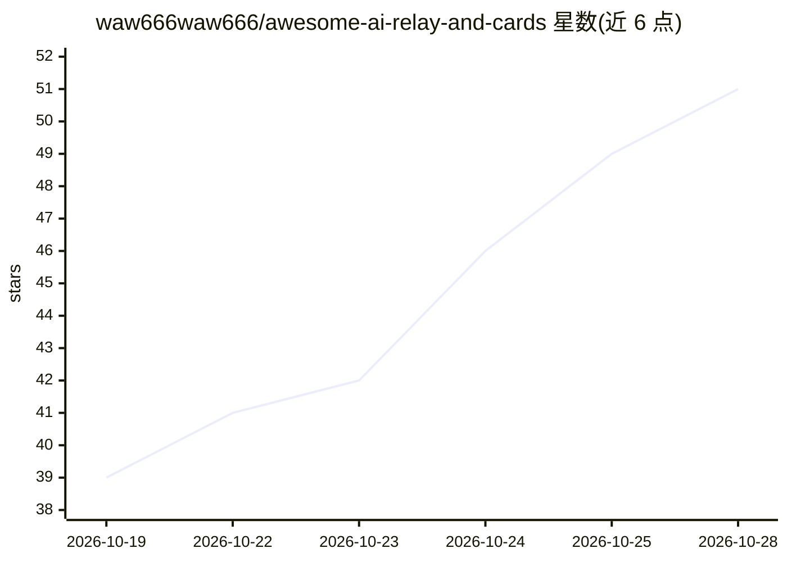

# waw666waw666/awesome-ai-relay-and-cards

⭐ 54 · Python · 推送 2026-10-26 · [GitHub](https://github.com/waw666waw666/awesome-ai-relay-and-cards) · [官网](https://github.com/waw666waw666/awesome-ai-relay-and-cards) · 个人维护 · 中文 README

**AI 发卡比价与 API 中转站评测收录清单（40 家）**

收录并评测 16 家 AI 发卡聚合比价平台与 24 家 API 中转服务商的精选指南：按多智能体打分体系（中立风控 35% + 数据功能 35% + 体验直连 30%）给出 T0/T1 分级榜单，附维度分、官网链接与特性描述；覆盖真假官转鉴定、可用率测速、倍率换算等评测重点。声明纯技术实验、零商业推广，含免责声明、资金安全警示与无条件移除流程，社区可通过 Issues 提交勘误。

## 筛选速览

| 维度 | 判定 | 备注 |
|---|---|---|
| AI 角色 | `ai-knowledge` | 知识聚合/清单类 |
| 许可风险 | `none` | — |
| 部署形态 | `None` |  |
| 模型依赖 | — | README 未给出锁定关系 |
| 硬件要求 | — | 无带数字的原话,不猜 |
| 安装摩擦 | `low` | 无编译、无系统依赖或容器化 |
| 成熟度 | — | 结构信号不足 |

## 能力要点

- 收录 16 家发卡比价平台与 24 家 API 中转服务商
- 三维度加权打分体系（35%/35%/30%）并给出 T0/T1 分级
- 含真假官转鉴定、可用率测速、倍率换算等评测维度
- 提供无条件移除流程与社区勘误渠道

## 适用场景

- 挑选 AI 订阅成品号或兑换码的比价平台
- 开发者挑选与鉴定 API 中转服务商
- 了解中转站的可用率、倍率与真伪检测情况

## 场景标签

`精选清单` · 领域:学习与行业

## 证据(README 行号)

> L5: > 本项目全量收录并独立评测主流第三方 **AI 发卡聚合比价平台（16 家）** 与 **API 中转服务商（24 家）**，纯技术实验与公开信息整理，零商业推广，无人工干预。
> L11: |**卡网聚合比价榜**|ChatGPT、Claude、Gemini 订阅、成品号与兑换码比价（收录 16 家）|`卡网完整榜`|
> L12: |**API 中转站全量榜**|开发者接口调用、真假官转鉴定、实时可用率测速与倍率换算（收录 24 家）|`中转站全量榜`|

## 星数曲线

2026-10-19 39 → 2026-10-28 51（+12）

---
*卡片 v1 · prompt 1.4 · 生成 2026-10-24 · 置信度 high · 依据 README sha `8762fb6fa7c8` · [字段定义](../../DATASET.md)*
