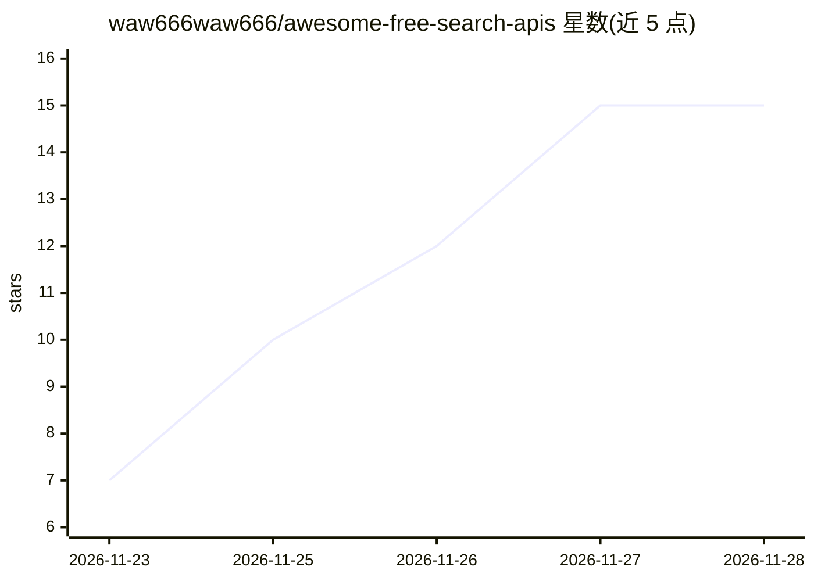

# waw666waw666/awesome-free-search-apis

⭐ 15 · Apache-2.0 · 推送 2026-11-24 · [GitHub](https://github.com/waw666waw666/awesome-free-search-apis) · 个人维护 · 中文 README

**给无法联网的 AI 配免费搜索/抓取/嵌入 API 额度的清单**

一份汇总免费搜索类 API 额度的清单：收录搜索、网页正文提取、嵌入/重排、平台数据抓取四类服务，每条写明免费额度数量、是否需绑卡、刷新周期、注册领取步骤、实测踩坑与实测日期；收录标准为免费、不绑卡、作者亲手注册并确认额度到账，失效优惠标注但不删除。面向为 AI 智能体或 RAG 项目接入搜索能力的开发者。

## 筛选速览

| 维度 | 判定 | 备注 |
|---|---|---|
| AI 角色 | `ai-knowledge` | 知识聚合/清单类 |
| 许可风险 | `permissive` | Apache-2.0 |
| 部署形态 | `None` |  |
| 模型依赖 | — | README 未给出锁定关系 |
| 硬件要求 | — | 无带数字的原话,不猜 |
| 安装摩擦 | `low` | 无编译、无系统依赖或容器化 |
| 成熟度 | — | 结构信号不足 |

## 能力要点

- 收录 7 个服务，每条含免费额度、绑卡要求、领取步骤与实测日期
- 汇总表换算每家免费额度约可调用次数
- 收录标准：亲手注册、控制台确认到账；失效优惠标注不删

## 适用场景

- 给不能联网的 AI 智能体接一个搜索接口
- 用免费额度跑通 RAG 或研究助手项目
- 挑选量大的搜索 API 先验证流程再付费

## 场景标签

`精选清单` · 领域:学习与行业

## 证据(README 行号)

> L13: ## 这是什么
> L17: 很多 AI 和智能体本身不会联网：问它今天的新闻、最新的文档、某个报错的新解法，它都答不上来。这个清单把能给它们补上搜索能力的 API 集中到一处——搜索、抓网页正文、做嵌入/重排——每家写清免费额度、领取步骤和实测踩过的坑，全部
> L25: **收录标准**：免费、不绑卡、亲手实测到账。没验过的传闻不收，抄来的名单不收。

## 星数曲线

2026-11-23 7 → 2026-11-28 15（+8）

---
*卡片 v1 · prompt 1.4 · 生成 2026-11-23 · 置信度 high · 依据 README sha `e855a88909c0` · [字段定义](../../DATASET.md)*
