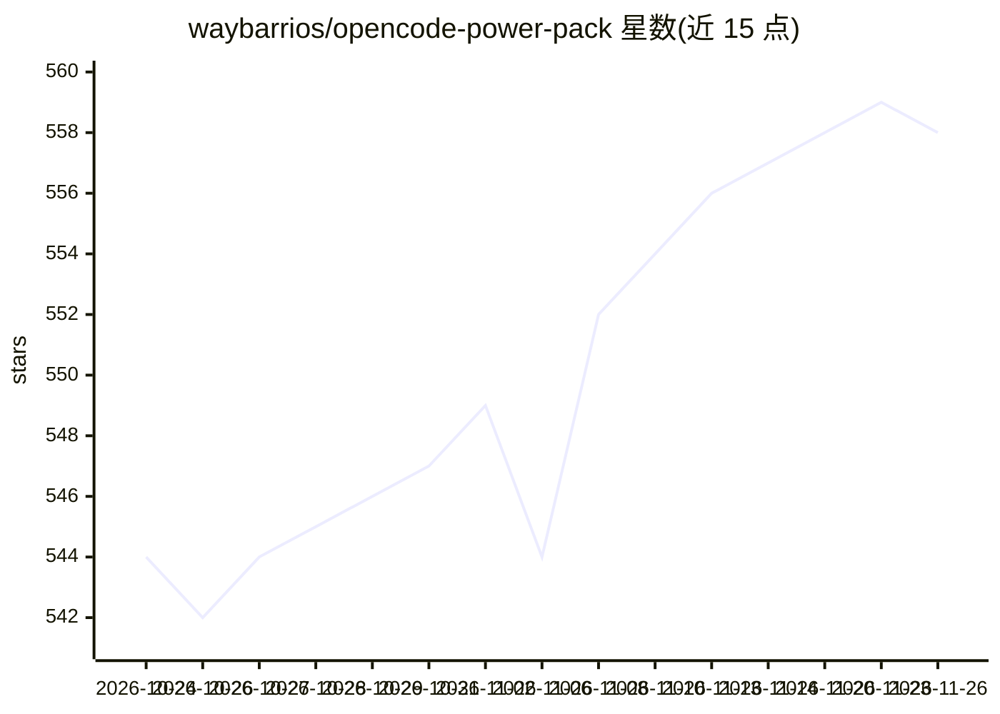

# waybarrios/opencode-power-pack

⭐ 558 · Python · MIT · 推送 2026-11-23 · [GitHub](https://github.com/waybarrios/opencode-power-pack) · [官网](https://skills.waybarrios.com) · 个人维护

**为 Claude Code/Codex/OpenCode/Pi 提供 55 个编码工作流技能包**

一个可安装到多种编码 agent 的技能（skills）集合，共 55 个，覆盖代码评审、安全审计、功能开发、前端设计、项目记忆、技术写作及 Hugging Face 模型发现/训练等。通过各宿主的插件机制（Claude Code plugin、Codex plugin、OpenCode plugin、Pi package）或 npm CLI 选择性安装到 .agents/skills 目录。每个技能绑定最小权限沙箱配置档（observe/develop/network-read/publish），v0.5.0 起提供基于 macOS Seatbelt 与 Linux Bubblewrap 的 shell-contained 沙箱运行器。沙箱要求 Node.js 20.11+；Windows 原生环境未支持。

## 筛选速览

| 维度 | 判定 | 备注 |
|---|---|---|
| AI 角色 | `ai-ecosystem` | LLM/agent 周边工具 |
| 许可风险 | `permissive` | MIT |
| 部署形态 | `desktop` | 安装包/桌面程序 |
| 模型依赖 | — | README 未给出锁定关系 |
| 硬件要求 | — | 无带数字的原话,不猜 |
| 安装摩擦 | `medium` | 含编译或系统依赖之一 |
| 成熟度 | — | 结构信号不足 |

## 能力要点

- 55 个技能按 8 个配置档（recommended/review/security/frontend/huggingface 等）分组安装
- 为四种编码 agent 提供统一的最小权限沙箱契约与 fail-closed 执行器
- npm CLI 支持选择性安装、dry-run 预览、项目级安装与回滚
- GitHub Packages 提供镜像安装源

## 适用场景

- 给 Claude Code 或 Codex 会话添加代码评审与安全审计工作流
- 按配置档为 agent 安装 Hugging Face 模型训练相关技能
- 限制 agent 执行命令的文件/网络/发布权限

## 场景标签

`代码审查` `编码 Agent` `模型训练` · 领域:编码与开发

## 证据(README 行号)

> L5:  Fifty-five portable workflows for Claude Code, Codex, OpenCode 1 and 2, and Pi.
> L48: OpenCode Power Pack now includes an opt-in, fail-closed sandbox runner for safer command execution from **Codex, Op
> L226: The runner requires Node.js 20.11.0 or newer.

## 星数曲线

2026-10-24 544 → 2026-11-26 558（+14）

---
*卡片 v1 · prompt 1.4 · 生成 2026-11-25 · 置信度 high · 依据 README sha `0de51259ddcc` · [字段定义](../../DATASET.md)*
