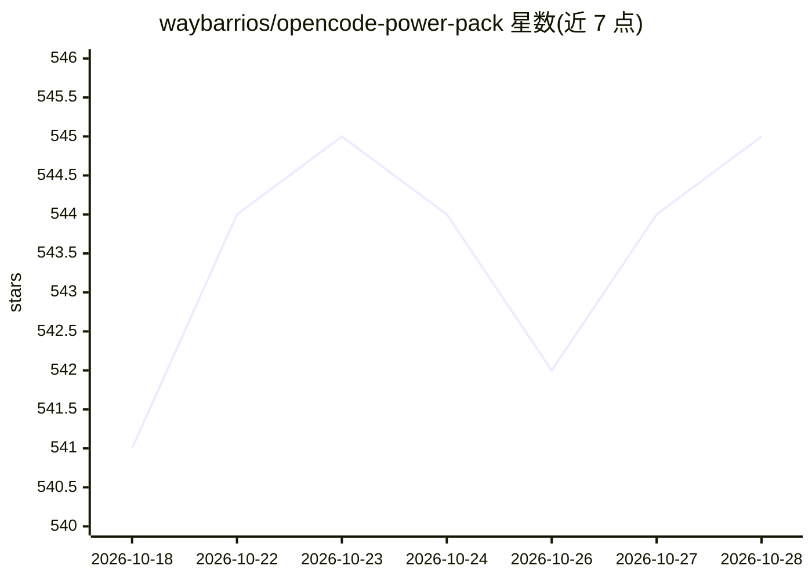

# waybarrios/opencode-power-pack

⭐ 545 · Python · MIT · 推送 2026-10-26 · [GitHub](https://github.com/waybarrios/opencode-power-pack) · [官网](https://skills.waybarrios.com) · 个人维护

**给 AI 编码代理的 55 个可移植技能包：审查/安全/开发/沙箱**

面向 Claude Code、Codex、OpenCode 1/2 与 Pi 四类编码代理的技能集合，共 55 个工作流，覆盖代码审查、安全审计、功能开发、前端设计、Hugging Face 模型训练与 MCP 工具制作，按 8 个 profile 组合分发。提供 opt-in 的 fail-closed 沙箱运行器（macOS 用 Seatbelt、Linux 用 Bubblewrap），四个最小权限档位。经 Claude Code/Codex 插件市场、pi install、npm 选择性安装或 git 源安装；npm v0.5.0 仅含 54 技能，humanizer 需从 main 分支 git 安装。CLI 需 Node.js ≥20.11.0。

## 筛选速览

| 维度 | 判定 | 备注 |
|---|---|---|
| AI 角色 | `ai-ecosystem` | LLM/agent 周边工具 |
| 许可风险 | `permissive` | MIT |
| 部署形态 | `desktop` | 安装包/桌面程序 |
| 模型依赖 | — | README 未给出锁定关系 |
| 硬件要求 | — | 无带数字的原话,不猜 |
| 安装摩擦 | `medium` | 含编译或系统依赖之一 |
| 成熟度 | `idea` | |

## 能力要点

- 55 个技能，支持 Claude Code/Codex/OpenCode 1+2/Pi 四类宿主
- opt-in fail-closed 沙箱运行器（Seatbelt/Bubblewrap，4 个最小权限档位）
- npm 选择性安装器按 profile/单技能安装到 .agents/skills，带回滚与锁定
- huggingface profile 覆盖模型发现、本地推理、训练与评估技能

## 适用场景

- 为常用编码代理补充代码审查与安全审计工作流
- 通过 profile 一次装齐某类开发场景所需技能
- 以沙箱运行器限制代理执行命令的权限边界

## 场景标签

`代码审查` · 领域:编码与开发

## 证据(README 行号)

> L5:  Fifty-five portable workflows for Claude Code, Codex, OpenCode 1 and 2, and Pi.
> L52: OpenCode Power Pack now includes an opt-in, fail-closed sandbox runner for safer command execution from **Codex, Op
> L103: Install only the workflows you want into the shared `.agents/skills` location recognized by Codex, OpenCode, and P

## 星数曲线

2026-10-18 541 → 2026-10-28 545（+4）

---
*卡片 v1 · prompt 1.4 · 生成 2026-10-21 · 置信度 high · 依据 README sha `3c9f6ec6a21f` · [字段定义](../../DATASET.md)*
