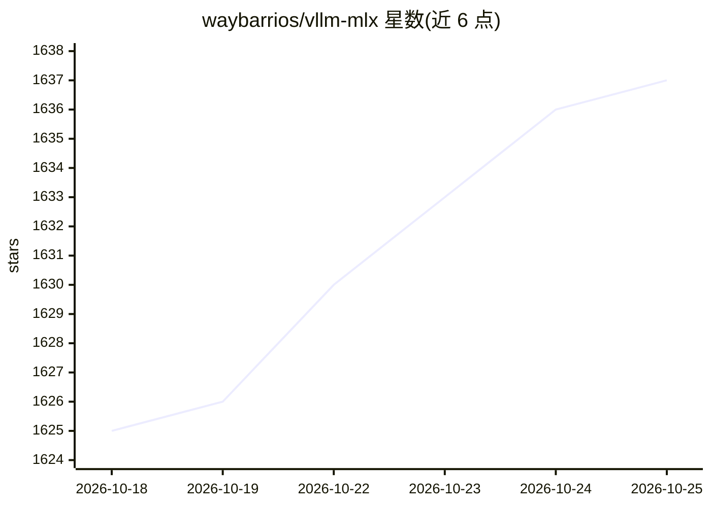

# waybarrios/vllm-mlx

⭐ 1,637 · Python · Apache-2.0 · 推送 2026-10-20 · [GitHub](https://github.com/waybarrios/vllm-mlx) · [官网](https://vllm-mlx.is-a.dev/) · 个人维护 · 中文 README

**Apple Silicon 上的本地 LLM 推理服务器：OpenAI/Anthropic 双协议**

基于 MLX 的 vLLM 风格推理服务器，仅在 Apple Silicon（M1–M5）上以 Metal 内核运行，统一内存、无需模型转换。单一进程同时暴露 OpenAI /v1/* 与 Anthropic /v1/messages 接口，提供连续批处理、分页 KV 缓存、前缀缓存与 SSD 分层缓存；支持文本、视觉、音频输入、TTS/STT、嵌入与重排。通过 pip/uv 安装，经环境变量即可接入 Claude Code 等编码 CLI。性能数据基于 M4 Max 实测给出。

## 筛选速览

| 维度 | 判定 | 备注 |
|---|---|---|
| AI 角色 | `ai-ecosystem` | LLM/agent 周边工具 |
| 许可风险 | `permissive` | Apache-2.0 |
| 部署形态 | `library` | 以包/库形式分发 |
| 模型依赖 | locked-api |  |
| 硬件要求 | — | 无带数字的原话,不猜 |
| 安装摩擦 | `medium` | 含编译或系统依赖之一 |
| 成熟度 | — | 结构信号不足 |

## 能力要点

- 单进程同时提供 OpenAI /v1/* 与 Anthropic /v1/messages 兼容接口
- 连续批处理、分页 KV 缓存、前缀缓存、SSD 分层 KV 缓存
- 多模态：文本/图像/视频/音频输入，TTS（11 声音）与 Whisper STT
- 19 种 MCP 工具调用解析器与结构化输出（JSON Schema）

## 适用场景

- 在 Mac 上本地部署 OpenAI/Anthropic 兼容的推理服务
- 为 Claude Code 等 CLI 编码客户端提供本地模型后端
- 长上下文 agent 场景下利用 SSD 分层缓存与前缀缓存
- 在同一服务器上运行嵌入、重排与多模态模型

## 场景标签

`推理引擎` `语音合成` `语音识别` `多模态` · 领域:内容生成

## 证据(README 行号)

> L16: A vLLM-style inference server for Apple Silicon Macs. Unlike `Ollama` or `mlx-lm` used directly, it ships **continu
> L30: vllm-mlx serve mlx-community/Llama-3.2-3B-Instruct-4bit --host 127.0.0.1 --port 8000
> L100: - Apple Silicon only (M1, M2, M3, M4, M5) with Metal kernels via MLX

## 星数曲线

2026-10-18 1,625 → 2026-10-25 1,637（+12）

---
*卡片 v1 · prompt 1.4 · 生成 2026-10-21 · 置信度 high · 依据 README sha `182d34749190` · [字段定义](../../DATASET.md)*
