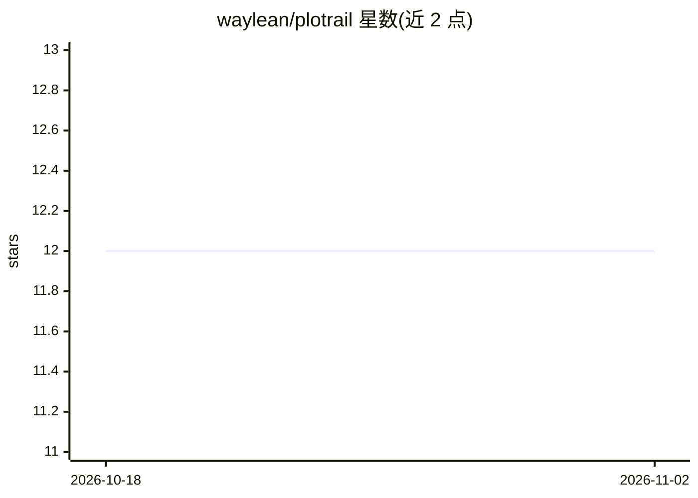

# waylean/plotrail

⭐ 12 · Python · MIT · 推送 2026-06-21 · [GitHub](https://github.com/waylean/plotrail) · 个人维护 · 中文 README

**给文件型 AI Agent 的长篇小说写作 Skill 工作流**

面向 Codex、Claude Code 等文件型 AI Agent 的长篇小说写作工作流，包含两个互补 Skill：plotrail 从脑洞出发建立 canon（故事圣经、人物、时间线）、生成章节合同与正文草稿并做连续性审稿；plotrail-intake 处理已有稿件，做诊断、逐章精修、风格学习与一致性审稿，产出 continuation_brief 交接。产物以结构化文件（canon/、drafts/、reviews/、memory/）形式维护。不绑定模型，通过 git clone 复制 SKILL.md 目录安装。

## 筛选速览

| 维度 | 判定 | 备注 |
|---|---|---|
| AI 角色 | `ai-ecosystem` | LLM/agent 周边工具 |
| 许可风险 | `permissive` | MIT |
| 部署形态 | `None` |  |
| 模型依赖 | — | README 未给出锁定关系 |
| 硬件要求 | — | 无带数字的原话,不猜 |
| 安装摩擦 | `low` | 无编译、无系统依赖或容器化 |
| 成熟度 | — | 结构信号不足 |

## 能力要点

- 先 canon、再章节合同、写完连续性审稿的工作流
- plotrail-intake 摄取旧稿：诊断、精修、风格学习、产出 continuation_brief
- 长期记忆与作者编辑画像（memory/ 下状态账本与偏好文件）
- 兼容任何支持 SKILL.md 与文件读写的 Agent，不绑定单一模型

## 适用场景

- 长篇连载中保持人物、设定、伏笔的连续性
- 把已写好的旧稿交给 AI 诊断与逐章精修
- 从作者改稿中沉淀偏好供后续章节使用

## 场景标签

`AI 写作` · 领域:内容生成

## 证据(README 行号)

> L13: PlotRail 是一个给 Codex、Claude Code 等文件型 AI Agent 使用的长篇小说工作流。它的目标不是让 AI 在一个聊天窗口里硬写完整本书，而是把小说变成一个能长期维护的项目。
> L15: 现在它包含两个互补的 Skill：
> L17: - `plotrail`：从脑洞、设定、章节合同开始，帮助你把长篇写下去。

## 星数曲线

2026-10-18 12 → 2026-11-02 12（+0）

---
*卡片 v1 · prompt 1.4 · 生成 2026-11-01 · 置信度 high · 依据 README sha `b25171a18d57` · [字段定义](../../DATASET.md)*
