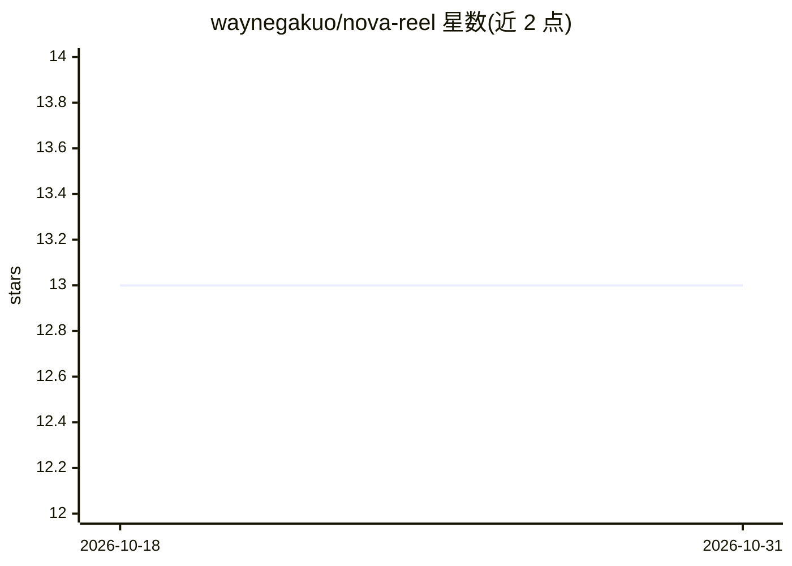

# waynegakuo/nova-reel

⭐ 13 · TypeScript · MIT · 推送 2026-07-09 · [GitHub](https://github.com/waynegakuo/nova-reel) · [官网](https://nova-reels.web.app/) · 个人维护

**AI 驱动的影视浏览与个性化推荐 Web 应用**

基于 Angular 的影视浏览与发现应用，数据来自 TMDB API，用 Firebase（Authentication/Firestore/Functions）做认证、存储与无服务器后端，通过 Google Genkit 框架调用 Gemini 3 Pro 提供 AI 功能：自然语言影视推荐、基于收藏的个性化推荐、截图识别影片、AI 生成的问答挑战与影评对话聊天。面向影视爱好者，需自行配置 Firebase 项目（Blaze 付费计划、Cloud Functions、Firestore）并部署运行。

## 筛选速览

| 维度 | 判定 | 备注 |
|---|---|---|
| AI 角色 | `ai-native` | 本体是模型或模型工具 |
| 许可风险 | `permissive` | MIT |
| 部署形态 | `library` | 以包/库形式分发 |
| 模型依赖 | — | README 未给出锁定关系 |
| 硬件要求 | — | 无带数字的原话,不猜 |
| 安装摩擦 | `low` | 无编译、无系统依赖或容器化 |
| 成熟度 | — | 结构信号不足 |

## 能力要点

- 自然语言查询生成影视推荐并附推荐理由
- 基于用户收藏（Firestore）的个性化推荐
- 截图识别影片并结合 TMDB API 校验与补全信息
- 详情页内嵌影评问答聊天与 AI 生成的问答挑战

## 适用场景

- 用自然语言描述想看的影片类型获取推荐
- 上传电影截图识别出自哪部影片
- 管理影视收藏与愿望清单并生成分享链接
- 就某部影片的影评与口碑与 AI 对话

## 场景标签

`推荐系统` `聊天机器人` · 领域:对话与助手

## 证据(README 行号)

> L27: - 🤖 **Smart Recommendations**: Natural language queries
> L29: - 🎬 **Guess the Movie**: Screenshot identification
> L31: - 💬 **AI Review Chat**: Chat with AI about reviews

## 星数曲线

2026-10-18 13 → 2026-10-31 13（+0）

---
*卡片 v1 · prompt 1.4 · 生成 2026-10-31 · 置信度 high · 依据 README sha `79ae6354a7f5` · [字段定义](../../DATASET.md)*
