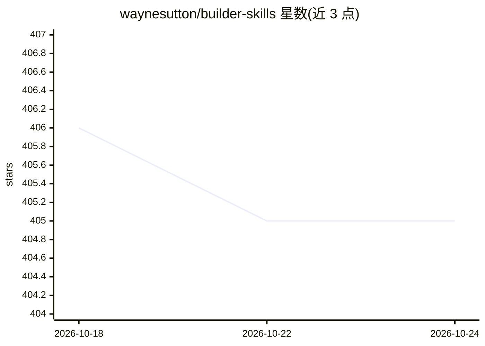

# waynesutton/builder-skills

⭐ 405 · JavaScript · Apache-2.0 · 推送 2026-09-28 · [GitHub](https://github.com/waynesutton/builder-skills) · [官网](https://www.npmjs.com/package/@waynesutton/builder-skills) · 个人维护

**给编码 Agent 用的 Convex 开发与项目工作流技能集（17 个）**

面向使用 Claude Code、Codex、Cursor、OpenCode 等 Agent 的开发者的 SKILL.md 技能库：17 个技能中 14 个教 Agent 按 Convex 文档规范开发（每个函数加 validator、索引用 withIndex、幂等 mutation、HTTP action 验签、不停机迁移等），3 个教项目工作流（先写 PRD、用 git 证据维护 task.md/changelog.md/files.md、禁止破坏性 git 命令）。提供 npx 安装器、Claude Code 插件市场与 npm CLI 三种安装方式，技能按渐进披露结构组织，官方 Convex 技能另在 get-convex/convex-agent-plugins。

## 筛选速览

| 维度 | 判定 | 备注 |
|---|---|---|
| AI 角色 | `ai-ecosystem` | LLM/agent 周边工具 |
| 许可风险 | `permissive` | Apache-2.0 |
| 部署形态 | `library` | 以包/库形式分发 |
| 模型依赖 | — | README 未给出锁定关系 |
| 硬件要求 | — | 无带数字的原话,不猜 |
| 安装摩擦 | `low` | 无编译、无系统依赖或容器化 |
| 成熟度 | — | 结构信号不足 |

## 能力要点

- 14 个 Convex 开发规范技能 + 3 个项目工作流技能
- SKILL.md 按渐进披露组织：description 触发、正文按需、references 一跳之遥
- project-docs 从 git 证据更新 changelog/files/task 三份文档
- git-safety 技能要求破坏性 git 命令须用户逐条确认

## 适用场景

- 让编码 Agent 按 Convex 官方文档规范写代码
- 用 PRD + task.md + changelog 流程管理 Agent 开发的项目
- 防止 Agent 执行可丢失工作的 git 命令

## 场景标签

 · 领域:开发者工具/Agent 技能

## 证据(README 行号)

> L7: Agent skills for builders shipping Convex apps. By Wayne Sutton.
> L11: They work with Claude Code, Codex, Cursor, OpenCode, and anything else that reads a `SKILL.md`.

## 星数曲线

2026-10-18 406 → 2026-10-24 405（-1）

---
*卡片 v1 · prompt 1.4 · 生成 2026-10-21 · 置信度 high · 依据 README sha `402ca984c186` · [字段定义](../../DATASET.md)*
