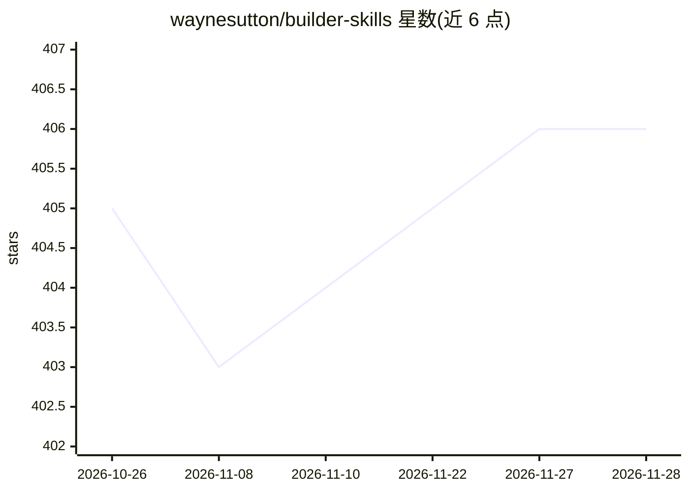

# waynesutton/builder-skills

⭐ 406 · JavaScript · Apache-2.0 · 推送 2026-11-14 · [GitHub](https://github.com/waynesutton/builder-skills) · [官网](https://www.npmjs.com/package/@waynesutton/builder-skills) · 个人维护

**为使用 Convex 开发的程序员提供 11 个编码 agent 技能**

面向用 Convex 开发应用的程序员的 agent 技能包，包含 11 个 SKILL.md 格式技能，覆盖工作流（分诊、PRD、任务/变更/文件文档同步）、编码（根因分析、状态机审计）、安全检查（密钥扫描、鉴权验证）与写作四类。通过 npx CLI 或 skills.sh 安装到 Claude Code、Codex、Cursor、OpenCode 等 agent 的技能目录，并生成 AGENTS.md、SECURITY.md 等项目模板。Convex API 相关技能已迁移至官方技能集，本仓库只保留非 Convex API 的交付环节。

## 筛选速览

| 维度 | 判定 | 备注 |
|---|---|---|
| AI 角色 | `ai-knowledge` | 知识聚合/清单类 |
| 许可风险 | `permissive` | Apache-2.0 |
| 部署形态 | `library` | 以包/库形式分发 |
| 模型依赖 | — | README 未给出锁定关系 |
| 硬件要求 | — | 无带数字的原话,不猜 |
| 安装摩擦 | `low` | 无编译、无系统依赖或容器化 |
| 成熟度 | — | 结构信号不足 |

## 能力要点

- 11 个技能覆盖工作流、编码、安全、写作四类，以 SKILL.md 文件分发
- sec-check 技能内置密钥扫描脚本，要求 agent 证明攻击路径后才判定为发现
- 支持 --target 指定 claude/codex/cursor/opencode 等 agent 目录，可选 --link 符号链接
- 提供 listSkills/getSkill 等 API 供程序化读取技能清单

## 适用场景

- 让编码 agent 按 PRD-任务-文档流程管理 Convex 项目的多步开发
- 部署或开源仓库前用 sec-check 做安全检查
- 从 git 记录自动同步 changelog 与项目文档
- 让 agent 用作者的个人风格起草文档与提交信息

## 场景标签

`编码 Agent` `代码审查` · 领域:编码与开发

## 证据(README 行号)

> L7: Workflow, building, and writing skills for builders shipping Convex apps. By Wayne Sutton.
> L9: Eleven skills that teach a coding agent how to run a project: triage before code, write a PRD, keep `task.md`, `chan
> L12: npx builder-skills

## 星数曲线

2026-10-26 405 → 2026-11-28 406（+1）

---
*卡片 v1 · prompt 1.4 · 生成 2026-11-25 · 置信度 high · 依据 README sha `0cc359e229c5` · [字段定义](../../DATASET.md)*
