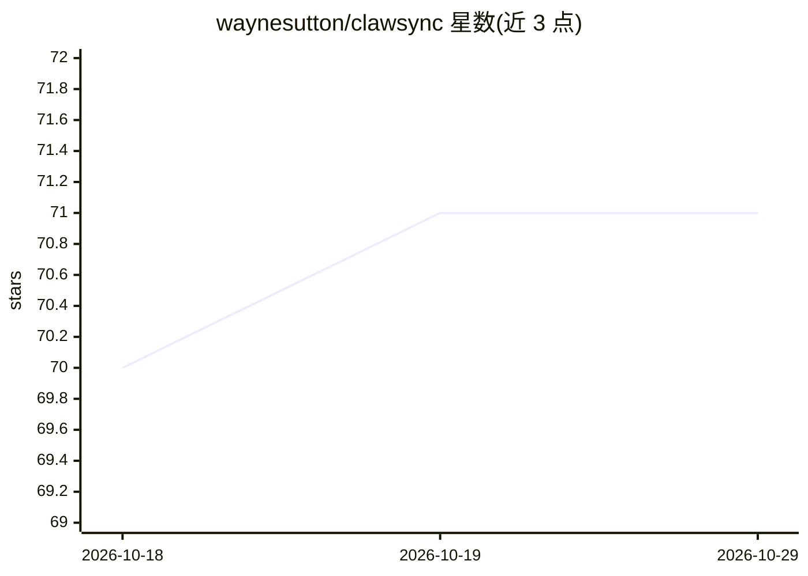

# waynesutton/clawsync

⭐ 71 · TypeScript · MIT · 推送 2026-02-11 · [GitHub](https://github.com/waynesutton/clawsync) · [官网](https://clawsync.dev/) · 个人维护

**部署在云端的个人 AI agent 平台：多 agent、聊天 UI、技能与 MCP**

基于 Convex 构建的开源个人 AI agent 应用，定位为『云端的 OpenClaw』：支持同时运行多个 agent（各自独立配置、技能、MCP 服务器与记忆），提供实时流式聊天 UI 与 SyncBoard 私有管理面板。模型层支持 Claude、GPT、Grok、Gemini 及任意 OpenRouter 模型，可按 agent 配置；集成 Telegram/Discord/WhatsApp/Slack/Email 渠道、X（Twitter）读写、Stagehand 浏览器自动化与 Firecrawl 网页抓取。部署需 Node.js 18+、Convex 账户与模型 API key，通过 git clone + npm install + npx convex dev 本地初始化后部署到 Convex。

## 筛选速览

| 维度 | 判定 | 备注 |
|---|---|---|
| AI 角色 | `ai-native` | 本体是模型或模型工具 |
| 许可风险 | `permissive` | MIT |
| 部署形态 | `library` | 以包/库形式分发 |
| 模型依赖 | locked-api |  |
| 硬件要求 | — | 无带数字的原话,不猜 |
| 安装摩擦 | `low` | 无编译、无系统依赖或容器化 |
| 成熟度 | — | 结构信号不足 |

## 能力要点

- 多 agent 并行运行，支持 agent 间通信与任务委派
- 多模型路由：Claude/GPT/Grok/Gemini/OpenRouter 按 agent 配置
- MCP 支持：可连接 MCP 服务器或将 agent 暴露为 MCP 服务器
- 模板/Webhook/代码三类技能体系及技能市场
- 渠道集成：Telegram、Discord、WhatsApp、Slack、Email、X（Twitter）

## 适用场景

- 部署自己的云端个人 AI agent 并通过聊天界面交互
- 让 agent 自动回复社交媒体提及并代发推文
- 通过网页抓取与浏览器自动化让 agent 执行在线任务
- 统一管理多个 agent 的技能、记忆与集成

## 场景标签

`AI 助手` `多智能体` `浏览器自动化` `网页抓取` · 领域:Agent 开发

## 证据(README 行号)

> L5: OpenClaw for the cloud.
> L16: - **Public Chat UI** - Clean, real-time chat with streaming responses and agent selector
> L19: - **Multi-Model** - Claude, GPT, Grok, Gemini, or any OpenRouter model (configurable per agent)

## 星数曲线

2026-10-18 70 → 2026-10-29 71（+1）

---
*卡片 v1 · prompt 1.4 · 生成 2026-10-24 · 置信度 high · 依据 README sha `9427577a43f9` · [字段定义](../../DATASET.md)*
