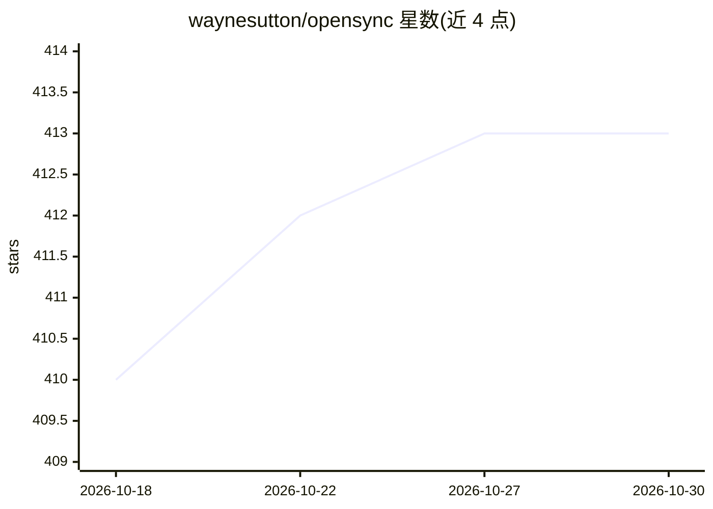

# waynesutton/opensync

⭐ 413 · TypeScript · MIT · 推送 2026-10-04 · [GitHub](https://github.com/waynesutton/opensync) · [官网](https://www.opensync.dev/) · 个人维护

**面向 AI 编码会话的云同步仪表盘与评测数据集导出工具**

为 OpenCode、Claude Code、Codex、Cursor、Factory Droid、Pi 等编码代理提供会话云同步与仪表盘：实时同步会话、统计工具用量与 token 花费，支持全文/语义/混合搜索，可打标签并导出 DeepEval JSON、OpenAI Evals JSONL 等评测数据集，另提供带认证的 API（同步、搜索、取上下文）。通过各代理的 npm 同步插件接入；可自托管（需 Convex、WorkOS、OpenAI 账号），也可用 opensync.dev 托管版。

## 筛选速览

| 维度 | 判定 | 备注 |
|---|---|---|
| AI 角色 | `ai-ecosystem` | LLM/agent 周边工具 |
| 许可风险 | `permissive` | MIT |
| 部署形态 | `library` | 以包/库形式分发 |
| 模型依赖 | locked-api |  |
| 硬件要求 | — | 无带数字的原话,不猜 |
| 安装摩擦 | `low` | 无编译、无系统依赖或容器化 |
| 成熟度 | — | 结构信号不足 |

## 能力要点

- 多编码代理会话实时云同步与统一仪表盘
- 全文/语义/混合搜索及面向 RAG 的上下文检索 API
- 导出 DeepEval JSON、OpenAI Evals JSONL 评测数据集
- 提供同步/搜索/导出的认证 API 与自托管路径

## 适用场景

- 跨项目追踪我在各编码代理中的会话与 token 花费
- 把历史会话整理成评测数据集用于评估模型
- 通过语义搜索找回相关历史会话作为 RAG 上下文

## 场景标签

`模型评测` `语义搜索` · 领域:评测与运维

## 证据(README 行号)

> L5: Cloud-synced dashboards that track session activity, tool usage, and token spend. Build eval datasets across project
> L29: |Export|DeepEval JSON, OpenAI Evals JSONL, plain text|

## 星数曲线

2026-10-18 410 → 2026-10-30 413（+3）

---
*卡片 v1 · prompt 1.4 · 生成 2026-10-21 · 置信度 high · 依据 README sha `277224d5a46e` · [字段定义](../../DATASET.md)*
