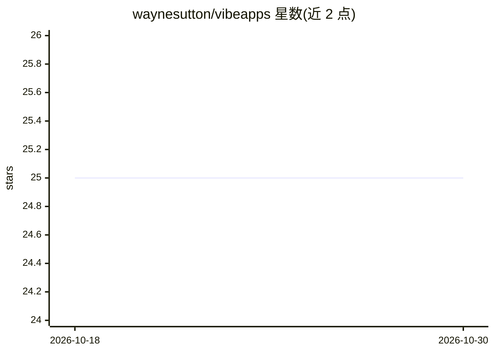

# waynesutton/vibeapps

⭐ 25 · TypeScript · 推送 2026-10-26 · [GitHub](https://github.com/waynesutton/vibeapps) · [官网](https://vibeapps.dev) · 个人维护

**应用展示社区平台：提交、评分与竞赛评审 App 目录**

基于 React 18、TypeScript、Convex 实时数据库与 Clerk 认证的全栈社区平台，面向希望展示作品和发现他人应用的开发者。功能包括应用提交（多图、视频、匿名提交）、标签与全文搜索、评论/评分/投票、关注与私信、实时通知、管理后台与内容审核，以及完整的黑客松评审系统（自定义加权评分标准、评委管理、CSV/ZIP 导出、公开结果页）。集成 Resend 邮件（日报、周报、广播）。部署到 Netlify，需自备 Convex 与 Clerk 账号。

## 筛选速览

| 维度 | 判定 | 备注 |
|---|---|---|
| AI 角色 | `ai-knowledge` | 知识聚合/清单类 |
| 许可风险 | `none` | — |
| 部署形态 | `library` | 以包/库形式分发 |
| 模型依赖 | — | README 未给出锁定关系 |
| 硬件要求 | — | 无带数字的原话,不猜 |
| 安装摩擦 | `low` | 无编译、无系统依赖或容器化 |
| 成熟度 | — | 结构信号不足 |

## 能力要点

- 应用提交、评分、投票与每周排行榜社区功能
- 完整评审系统：自定义加权标准、评委进度追踪、结果 CSV/ZIP 导出
- 动态表单构建器支持定制提交表单（如 YC AI Hackathon）
- Resend 邮件基础设施：日报、周报、管理广播与全局限流开关

## 适用场景

- 搭建黑客松作品提交与评审平台
- 运营应用展示社区，含评论、投票与排行榜
- 组织多评委、多标准的竞赛并导出结果

## 场景标签

 · 领域:开发者社区/应用目录

## 证据(README 行号)

> L3: The community where you go to show off what you've built, and see what others are building. Built with React, TypeSc
> L56: - **Submit Form System**: Create specialized submission forms (e.g., YC AI Hackathon) with custom fields

## 星数曲线

2026-10-18 25 → 2026-10-30 25（+0）

---
*卡片 v1 · prompt 1.4 · 生成 2026-10-26 · 置信度 low · 依据 README sha `f749be37a652` · [字段定义](../../DATASET.md)*
