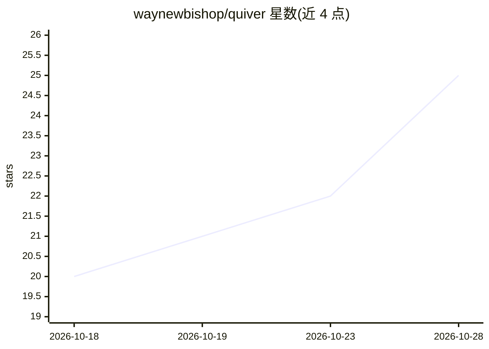

# waynewbishop/quiver

⭐ 25 · Swift · Apache-2.0 · 推送 2026-10-27 · [GitHub](https://github.com/waynewbishop/quiver) · 个人维护

**纯 Swift 的统计、线性代数与机器学习框架，零依赖**

用 Swift Package Manager 安装的纯 Swift 数值计算包，零外部依赖，覆盖向量/矩阵运算、统计、数据准备（Panel/Pipeline/交叉验证）、机器学习模型（Naive Bayes、KNN、线性/逻辑/岭回归、K-Means、PCA 等，统一 fit/predict 且参数可查、模型 Codable）、信号处理与文本嵌入检索。面向学生、教育者与 Apple 平台开发者，通过扩展标准 Array 类型使用，可在 iPhone、Apple Watch 与服务端 Swift 上运行；附带 Mac 端 Notebook（含预装数据集）与 73 个 Cookbook 示例。

## 筛选速览

| 维度 | 判定 | 备注 |
|---|---|---|
| AI 角色 | `ai-native` | 本体是模型或模型工具 |
| 许可风险 | `permissive` | Apache-2.0 |
| 部署形态 | `None` |  |
| 模型依赖 | — | README 未给出锁定关系 |
| 硬件要求 | — | 无带数字的原话,不猜 |
| 安装摩擦 | `low` | 无编译、无系统依赖或容器化 |
| 成熟度 | — | 结构信号不足 |

## 能力要点

- 零外部依赖的纯 Swift 实现，扩展标准 Array 类型
- 机器学习模型统一 fit/predict API，参数可检视，模型为 Codable 值类型
- 附带 Notebook（预装数据集）与 73 个 Cookbook 交互示例
- 运行于全部 Apple 平台与服务端 Swift，Quiver 本体支持 Linux

## 适用场景

- Swift 课程或自学中做统计与机器学习练习
- 在 iOS/watchOS 应用中原型化并部署训练好的模型
- 服务端 Swift 中做数值计算与数据分析

## 场景标签

 · 领域:数值计算/机器学习

## 证据(README 行号)

> L9: Quiver is an open-source Swift package for statistics, linear algebra, and machine learning — zero external dependen
> L79: - **Machine learning** — Naive Bayes, K-Nearest Neighbors, Linear/Logistic/Ridge Regression, Gradient Descent, K-Me

## 星数曲线

2026-10-18 20 → 2026-10-28 25（+5）

---
*卡片 v1 · prompt 1.4 · 生成 2026-10-27 · 置信度 high · 依据 README sha `a42b2ff55f57` · [字段定义](../../DATASET.md)*
