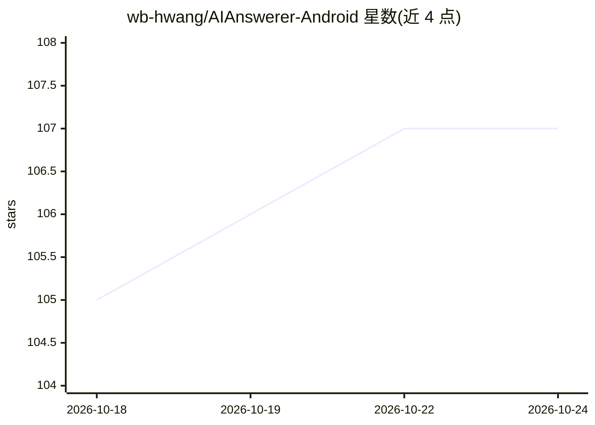

# wb-hwang/AIAnswerer-Android

⭐ 107 · Kotlin · MIT · 推送 2025-10-31 · [GitHub](https://github.com/wb-hwang/AIAnswerer-Android) · 个人维护 · 中文 README

**安卓悬浮窗截图答题应用：OCR 识别题目并调用大模型生成答案**

Android 端答题工具：通过悬浮窗一键截屏，使用 ML Kit OCR 识别题目文字（支持中英文、可手动校正），再调用 DeepSeek 等兼容 OpenAI 接口的模型生成解析，答案自动复制。覆盖选择题、填空题、问答题三类题型。API Key 由用户自行配置，可随时关闭网络请求；识别文字会上传至所选 AI 服务。安装方式为 APK，要求 Android 11 及以上，需授予悬浮窗、截屏、通知权限。

## 筛选速览

| 维度 | 判定 | 备注 |
|---|---|---|
| AI 角色 | `ai-native` | 本体是模型或模型工具 |
| 许可风险 | `permissive` | MIT |
| 部署形态 | `None` |  |
| 模型依赖 | locked-api |  |
| 硬件要求 | — | 无带数字的原话,不猜 |
| 安装摩擦 | `low` | 无编译、无系统依赖或容器化 |
| 成熟度 | — | 结构信号不足 |

## 能力要点

- 悬浮窗一键截屏，无需切换应用即可完成截屏、预览、提交
- OCR 识别中英文题目，提交前可手动编辑校正
- 支持选择题/填空题/问答题三类题型的解析生成，答案自动复制
- 自定义 API Key 与网络请求启停，识别文字发送至所选 AI 服务

## 适用场景

- 练习或自测时快速获取题目解析
- 对截图题目做 OCR 识别并查缺补漏
- 不切换应用的情况下连续刷新并解答多道题目

## 场景标签

 · 领域:教育/移动应用

## 证据(README 行号)

> L8: AI答题助手是一款基于 OCR 与大语言模型的安卓答题工具。通过悬浮窗截图识别题目，并调用 DeepSeek AI 等兼容 OpenAI 接口的模型为你快速给出答案，适用于练习、查缺补漏或自测场景。
> L13: - 🤖 AI 实时答题：根据题型生成解析，并自动复制答案

## 星数曲线

2026-10-18 105 → 2026-10-24 107（+2）

---
*卡片 v1 · prompt 1.4 · 生成 2026-10-23 · 置信度 high · 依据 README sha `451f674ba245` · [字段定义](../../DATASET.md)*
