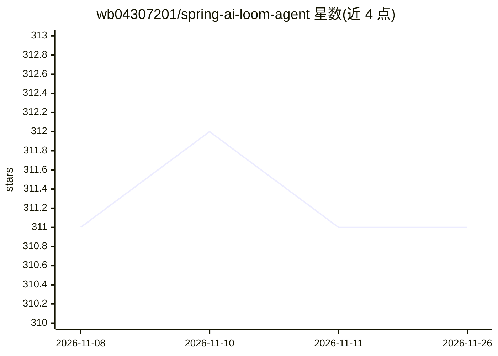

# wb04307201/spring-ai-loom-agent

⭐ 311 · Java · Apache-2.0 · 推送 2026-11-24 · [GitHub](https://github.com/wb04307201/spring-ai-loom-agent) · 个人维护 · 中文 README

**为 Spring Boot 应用提供开箱即用对话/记忆/工具调用能力的 AI Agent 框架**

以 Maven starter 形式发布的 Spring Boot AI Agent 框架：引入一个依赖即可为应用增加流式多轮对话、RAG 知识库（Tika 解析+内置 JVector 向量库，可替换为任意 Spring AI 向量库）、MCP 工具集成、子任务与定时任务、技能市场（数据库存储的提示词模板，带审批流）、RBAC 两级权限、管理控制台、文件管理与绘图画布。所有组件以接口+默认实现提供，可用 @ConditionalOnMissingBean 替换。另提供 5 个独立 MCP 服务器模块，可经 jbang 部署到 Claude Desktop、Cursor 等 MCP 兼容 agent。需配合 Spring AI 模型依赖（如 OpenAI 兼容 API）使用。

## 筛选速览

| 维度 | 判定 | 备注 |
|---|---|---|
| AI 角色 | `ai-ecosystem` | LLM/agent 周边工具 |
| 许可风险 | `permissive` | Apache-2.0 |
| 部署形态 | `self-host` | docker 或自建部署 |
| 模型依赖 | — | README 未给出锁定关系 |
| 硬件要求 | — | 无带数字的原话,不猜 |
| 安装摩擦 | `low` | 无编译、无系统依赖或容器化 |
| 成熟度 | — | 结构信号不足 |

## 能力要点

- Maven starter 单依赖接入，Spring Boot 自动配置，所有 bean 可替换
- RAG 知识库：多库管理、Tika 解析、内置 H2+JVector 向量存储，可换 Qdrant 等
- 技能市场与知识市场：数据库存储、审批流、角色分发
- 5 个独立 MCP 服务器模块（http/file/git/maven/compile），可部署到任意 MCP 兼容 agent

## 适用场景

- 给自己的 Spring Boot 应用快速加上带记忆和工具调用的对话能力
- 搭建带 RBAC 权限与技能市场的企业内部 AI 助手
- 把文件/Git/Maven/部署能力以 MCP 服务器形式接入 Claude Desktop 等客户端

## 场景标签

`Agent 框架` `RAG` · 领域:Agent 开发

## 证据(README 行号)

> L5: > Spring Boot AI Agent — an out-of-the-box solution that makes your app **converse**, **remember**, **think**, and *
> L78: ```xml
> L86: ### 2. Add a Spring AI Model Dependency

## 星数曲线



2026-11-08 311 → 2026-11-26 311（+0）


---
*卡片 v1 · prompt 1.4 · 生成 2026-11-17 · 置信度 mid · 依据 README sha `fef8d3008f86` · [字段定义](../../DATASET.md)*
