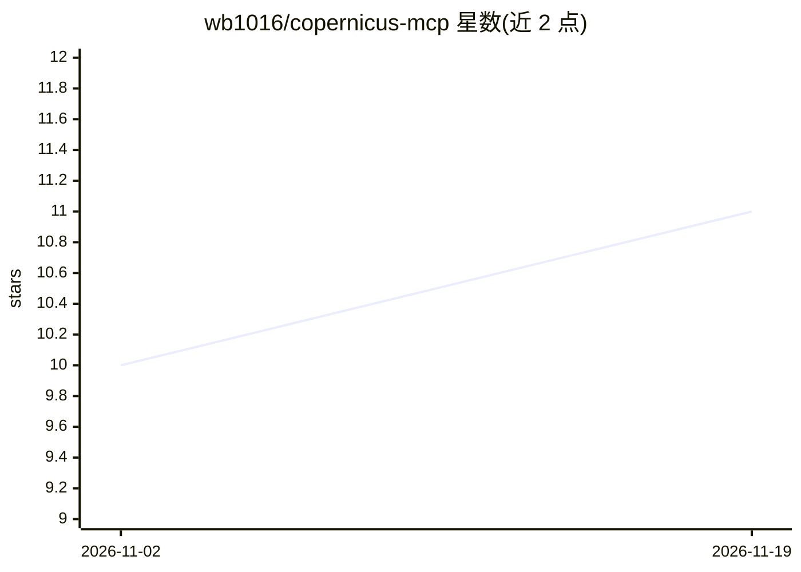

# wb1016/copernicus-mcp

⭐ 11 · Python · LGPL-3.0 · 推送 2026-10-15 · [GitHub](https://github.com/wb1016/copernicus-mcp) · 个人维护

**让 AI 客户端检索与下载 ESA 哨兵数据的 MCP 服务器**

封装 Copernicus Data Space Ecosystem OData API 的 MCP 服务器，为 MCP 客户端提供产品检索（点/包围盒/多边形、时间与任务过滤）、Sentinel-1 SLC burst 搜索与按需提取、后台下载任务（进度/限速/断点续传/MD5 校验）及下载目录管理等工具。限定 Sentinel-1/2/3/5P/6 集合，检索无需认证，下载需免费 CDSE 账号 token；后台任务仅存于内存，服务器重启不保留。

## 筛选速览

| 维度 | 判定 | 备注 |
|---|---|---|
| AI 角色 | `ai-ecosystem` | LLM/agent 周边工具 |
| 许可风险 | `viral` | LGPL-3.0 |
| 部署形态 | `self-host` | docker 或自建部署 |
| 模型依赖 | — | README 未给出锁定关系 |
| 硬件要求 | — | 无带数字的原话,不猜 |
| 安装摩擦 | `low` | 无编译、无系统依赖或容器化 |
| 成熟度 | — | 结构信号不足 |

## 能力要点

- 暴露 search_products、check_coverage 等 13 个 MCP 工具
- 后台下载任务支持进度、取消与 HTTP Range 断点续传
- 支持 GeoJSON/WKT 几何与服务端属性过滤
- 支持 stdio 与 HTTP 两种 transport，提供 Docker 运行方式

## 适用场景

- 在 MCP 客户端中按区域和时间检索 Sentinel 影像
- 批量后台下载多 GB 产品并校验完整性
- 按 swath/orbit 等条件搜索并提取 Sentinel-1 SLC burst
- 统计分析下载目录中的历史数据

## 场景标签

`科研工具` · 领域:学习与行业

## 证据(README 行号)

> L3: An MCP server for Copernicus **Sentinel**
> L69: copernicus-mcp                          # stdio transport (default)
> L91: |`search_products`|Search Sentinel products (geometry, dates, mission filters, attributes)|

## 星数曲线

2026-11-02 10 → 2026-11-19 11（+1）

---
*卡片 v1 · prompt 1.4 · 生成 2026-11-19 · 置信度 high · 依据 README sha `945d8306c935` · [字段定义](../../DATASET.md)*
