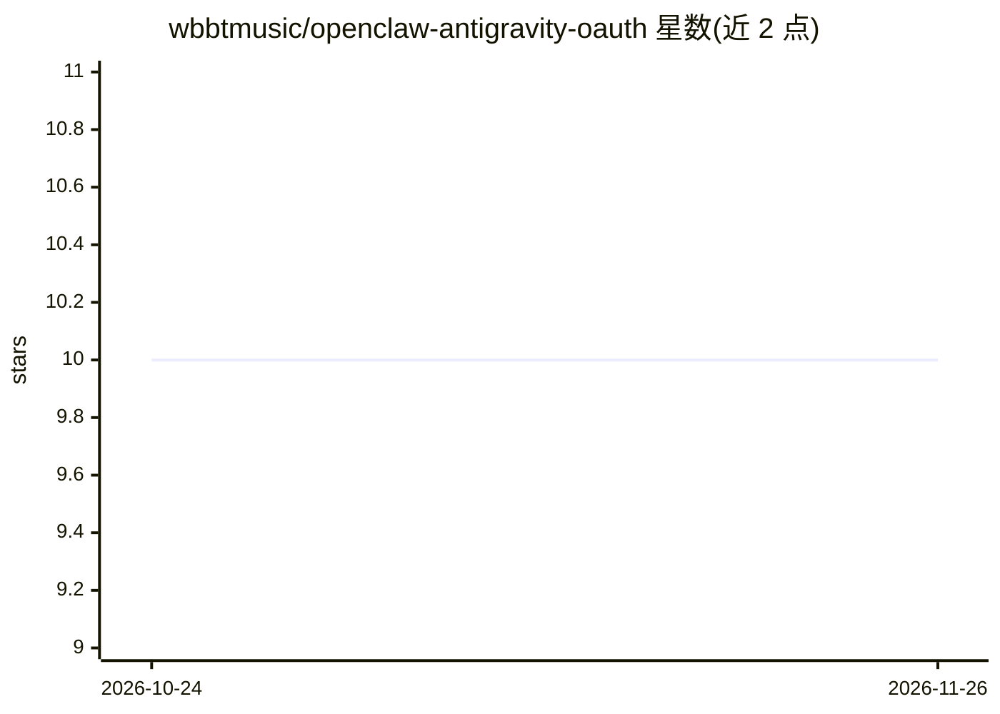

# wbbtmusic/openclaw-antigravity-oauth

⭐ 10 · JavaScript · MIT · 推送 2026-03-05 · [GitHub](https://github.com/wbbtmusic/openclaw-antigravity-oauth) · 个人维护

**让 OpenClaw 用 Google 账号 OAuth 免密调用 Gemini 与 Claude 模型的插件**

为 OpenClaw 提供的第三方插件，恢复已被移除的 google-antigravity-auth 接入通道：通过 Google OAuth 2.0 PKCE 登录获取凭证，并运行一个本地 API 代理（端口 51199）完成新旧的 Cloud Code Assist API 格式转换、令牌自动刷新、客户端版本头伪装与 thinkingConfig/工具调用格式桥接。支持 8 个 Gemini 与 Claude 模型条目。README 标注使用可能违反 Google 服务条款并存在账号受限风险，建议使用辅助账号。安装需 Node.js/npm 并部署 systemd 代理服务。

## 筛选速览

| 维度 | 判定 | 备注 |
|---|---|---|
| AI 角色 | `ai-ecosystem` | LLM/agent 周边工具 |
| 许可风险 | `permissive` | MIT |
| 部署形态 | `library` | 以包/库形式分发 |
| 模型依赖 | — | README 未给出锁定关系 |
| 硬件要求 | — | 无带数字的原话,不猜 |
| 安装摩擦 | `low` | 无编译、无系统依赖或容器化 |
| 成熟度 | — | 结构信号不足 |

## 能力要点

- Google OAuth PKCE 登录，无需 API key 与计费
- 本地代理做 API 格式翻译与令牌自动刷新
- 支持 8 个 Gemini/Claude 模型条目，含 thinking 模型
- 无需修改 OpenClaw 源码，适配任意版本

## 适用场景

- 让 OpenClaw 以 Google 账号免费调用 Gemini 3 系列模型
- 修复 2026 年 3 月后 Google API 格式变更导致的 400 报错
- 在无浏览器 VPS 上通过 SSH 转发完成 OAuth 登录

## 场景标签

`模型网关` · 领域:Agent 开发

## 证据(README 行号)

> L10: Google removed the built-in `google-antigravity-auth` provider from OpenClaw **and** changed the Cloud Code Assist 
> L236: 6. **Provider Config** — OpenClaw treats `google-antigravity` as an OpenAI-compatible provider pointing to the loc

## 星数曲线

2026-10-24 10 → 2026-11-26 10（+0）

---
*卡片 v1 · prompt 1.4 · 生成 2026-11-19 · 置信度 high · 依据 README sha `f5235587b992` · [字段定义](../../DATASET.md)*
