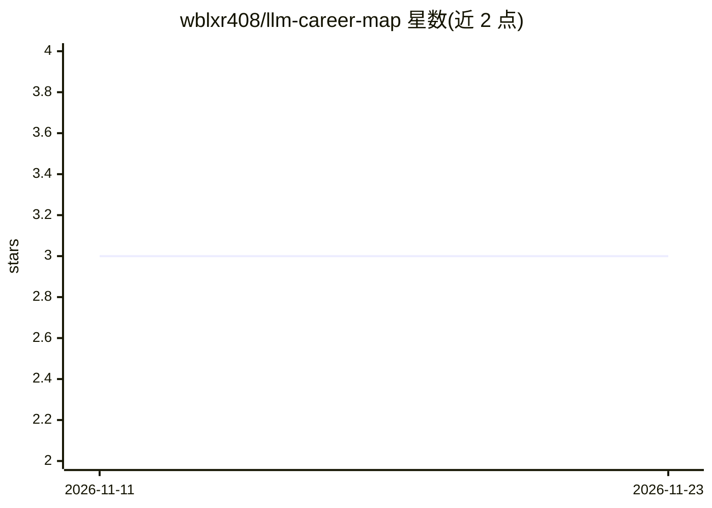

# wblxr408/llm-career-map

⭐ 3 · JavaScript · MIT · 推送 2026-10-12 · [GitHub](https://github.com/wblxr408/llm-career-map) · [官网](https://llm-master-web.vercel.app) · 个人维护 · 中文 README

**面向求职者的大模型学习与就业知识地图站点**

React+Vite 构建的静态学习站点，把 24 个资料仓库、1,987 份文档整理为 7 个求职阶段、18 个 Topic 与 6 条岗位路线，提供筛选检索、8 组固定样例教学动画（RAG、Attention、ReAct、LoRA 等）与收藏、进度等阅读功能。资料快照随仓库分发，演示无需模型 API key；要求 Node.js 22.12+ 本地运行，可部署到 Vercel 静态托管。内容为资料聚合与导读，自身不调用模型产出内容。

## 筛选速览

| 维度 | 判定 | 备注 |
|---|---|---|
| AI 角色 | `ai-knowledge` | 知识聚合/清单类 |
| 许可风险 | `permissive` | MIT |
| 部署形态 | `library` | 以包/库形式分发 |
| 模型依赖 | — | README 未给出锁定关系 |
| 硬件要求 | — | 无带数字的原话,不猜 |
| 安装摩擦 | `low` | 无编译、无系统依赖或容器化 |
| 成熟度 | — | 结构信号不足 |

## 能力要点

- 24 个仓库、1,987 份资料按 7 阶段/18 Topic/6 岗位路线组织
- 8 组交互演示讲解 RAG、Attention、ReAct、MCP、KV Cache、LoRA 等，无需 API key
- 来源追溯：保留原仓库、固定提交、Git blob 指纹与许可证
- 前端每 60 秒检查上游提交并增量同步到 IndexedDB

## 适用场景

- 按岗位路线系统学习大模型与求职准备知识
- 查找整理好的 LLM/RAG/Agent 笔记与面试面经
- 用交互动画理解 RAG、Attention、LoRA 等机制

## 场景标签

`教程课程` · 领域:学习与行业

## 证据(README 行号)

> L3: 把大模型笔记、面试题库、面经和就业资料整理成一张可以按岗位学习的地图。内置可操作的步骤动画，从理解技术原理一路连接到项目证据、简历投递和面试复盘。
> L16: 截至 2026-10-12，收录 **24 个仓库、1,987 份资料、18 个 Topic、6 条岗位路线、8 组交互演示**。1,206 份资料可在站内阅读全文，781 份保留原文索引；包含 7 篇本站就业导读。统计单位是文档
> L49: 这些是使用固定样例的教学演示，无需模型 API key。技术说明和演示边界见 实现文档。

## 星数曲线

2026-11-11 3 → 2026-11-23 3（+0）

---
*卡片 v1 · prompt 1.4 · 生成 2026-11-21 · 置信度 high · 依据 README sha `b47217dce81e` · [字段定义](../../DATASET.md)*
