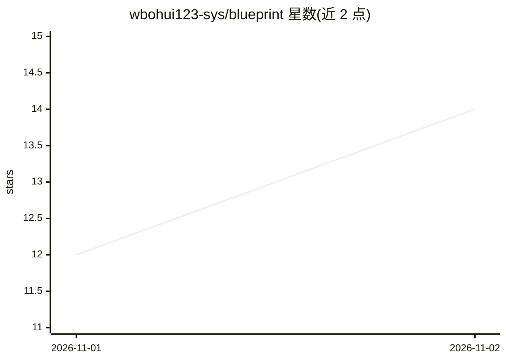

# wbohui123-sys/blueprint

⭐ 14 · JavaScript · AGPL-3.0 · 推送 2026-10-30 · [GitHub](https://github.com/wbohui123-sys/blueprint) · [官网](https://github.com/wbohui123-sys/blueprint/releases/latest) · 个人维护 · 中文 README

**可视化多智能体系统：一句话生成并指挥 AI 团队完成任务**

基于 Electron 的 macOS 桌面应用：用户输入一句话目标，系统生成一棵智能体树——Lead Producer 拆解阶段，各级 lead 再分派任务，专业 agent 在各自 git 分支工作区独立构建并逐层整合。每个 agent 是画布上一张卡片，可随时对话、停止或重启；支持接入 DeepSeek、OpenAI、Anthropic、Ollama 或任意 OpenAI 兼容端点，也可将大任务交给本机的 Codex 或 Claude Code。本体是 DeepSeek Harness 的插件集，纯 JavaScript 无构建步骤。当前仅支持 Apple Silicon Mac，应用未公证，自述为早期项目。

## 筛选速览

| 维度 | 判定 | 备注 |
|---|---|---|
| AI 角色 | `ai-ecosystem` | LLM/agent 周边工具 |
| 许可风险 | `viral` | AGPL-3.0 |
| 部署形态 | `desktop` | 安装包/桌面程序 |
| 模型依赖 | local-ok | 支持本地模型 |
| 硬件要求 | — | 无带数字的原话,不猜 |
| 安装摩擦 | `medium` | 含编译或系统依赖之一 |
| 成熟度 | `idea` | |

## 能力要点

- 一句话目标生成多级智能体树，结构随任务生长
- 实时画布查看每个 agent 的状态、产出与报告，可随时介入
- 每个 agent 独立 git 分支工作区，完成后合并
- 20+ 技能（Godot/Blender/Three.js 等）与本地工具一键安装

## 适用场景

- 输入一句话让 AI 团队规划、分工并构建游戏或报告等成品
- 在画布上监督多个并行 agent 的工作进度并随时干预
- 用不同模型组合对比完成同一任务的成本与效果

## 场景标签

`多智能体` · 领域:Agent 开发

## 证据(README 行号)

> L7:  A visual multi-agent system. One sentence becomes a team of AI agents that plan, split the work, build, and put it 
> L62: - **Bring your own workers.** Agents run on any model you connect. Big pieces can also go to Codex or Claude Code o
> L111: Blueprint is a set of plugins on top of DeepSeek Harness (dsh). Plain JavaScript, no build step.

## 星数曲线

2026-11-01 12 → 2026-11-02 14（+2）

---
*卡片 v1 · prompt 1.4 · 生成 2026-11-01 · 置信度 high · 依据 README sha `ca7e3b042b95` · [字段定义](../../DATASET.md)*
