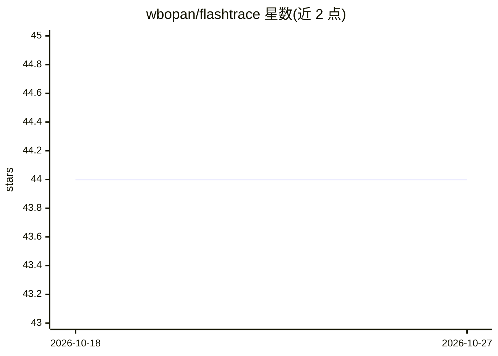

# wbopan/flashtrace

⭐ 44 · Python · MIT · 推送 2026-08-21 · [GitHub](https://github.com/wbopan/flashtrace) · [官网](https://pypi.org/project/flashtrace/) · 组织维护

**推理语言模型的多 token 归因工具：追溯生成内容来源的 prompt token**

面向研究者的 token 归因 Python 包：将选定的生成片段（最终答案或推理链段落）回溯到塑造它的 prompt token，输出 top-k 归因得分、JSON trace 与独立 HTML 热力图。方法结合 span 级聚合与递归归因，在长生成 span 上提速 130 倍以上，并在 RULER、MATH、HotpotQA 等任务上验证忠实性。支持 Qwen2/3、Qwen-VL、Llama 等解码器模型及视觉语言模型，提供 CLI 与 Python API；建议使用 CUDA GPU 运行公开规模模型。

## 筛选速览

| 维度 | 判定 | 备注 |
|---|---|---|
| AI 角色 | `ai-ecosystem` | LLM/agent 周边工具 |
| 许可风险 | `permissive` | MIT |
| 部署形态 | `library` | 以包/库形式分发 |
| 模型依赖 | — | README 未给出锁定关系 |
| 硬件要求 | — | 无带数字的原话,不猜 |
| 安装摩擦 | `medium` | 含编译或系统依赖之一 |
| 成熟度 | — | 结构信号不足 |

## 能力要点

- 生成 span → prompt token 的归因得分排序与 top-k 输出
- JSON trace 与独立 HTML token 热力图导出
- 支持视觉语言模型（Qwen3-VL / Qwen2.5-VL）的视觉 patch token 归因
- 提供 Python API、CLI 与 per-hop 归因面板

## 适用场景

- 检查推理模型的答案或思维链由哪些 prompt token 驱动
- 对长生成推理链做逐跳归因分析
- 生成可分享的 token 级热力图用于可解释性研究

## 场景标签

 · 领域:LLM 可解释性/科研工具

## 证据(README 行号)

> L29: Reasoning models produce long generated chains, final answers, and intermediate spans that deserve targeted inspect
> L314: FlashTrace implements the method described in Towards Long-Horizon Interpretability: Efficient and Faithful Multi-

## 星数曲线

2026-10-18 44 → 2026-10-27 44（+0）

---
*卡片 v1 · prompt 1.4 · 生成 2026-10-25 · 置信度 high · 依据 README sha `8875e4997881` · [字段定义](../../DATASET.md)*
