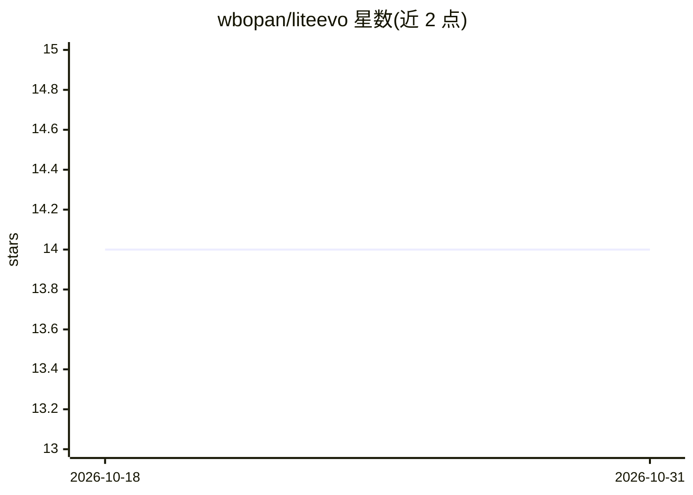

# wbopan/liteevo

⭐ 14 · Python · MIT · 推送 2025-12-31 · [GitHub](https://github.com/wbopan/liteevo) · 个人维护

**LLM 自进化调优工具：用任务与成功标准迭代生成 playbook**

面向开发者的 LLM 能力自进化工具：不改模型权重，而是让 LLM 反复尝试用户任务（生成回答→按批次积累结果→对照成功标准反思→更新 playbook），最终产出一份记录策略、陷阱与启发式的结构化 JSON 指导文档。支持 Claude（Claude Code CLI）、OpenAI 及兼容 API、Gemini CLI、Codex CLI 与任意自定义 CLI 作为执行 agent。以 Python 包形式通过 uv 运行，提供可自定义的 Jinja2 模板与 glob 多任务加载。限制：需预配置可用的 CLI agent 或 API key。

## 筛选速览

| 维度 | 判定 | 备注 |
|---|---|---|
| AI 角色 | `ai-ecosystem` | LLM/agent 周边工具 |
| 许可风险 | `permissive` | MIT |
| 部署形态 | `None` |  |
| 模型依赖 | locked-api |  |
| 硬件要求 | — | 无带数字的原话,不猜 |
| 安装摩擦 | `low` | 无编译、无系统依赖或容器化 |
| 成熟度 | — | 结构信号不足 |

## 能力要点

- 不改模型权重，迭代演化结构化 playbook（策略/检查清单/示例）
- 支持 claude/codex/gemini/openai/自定义 CLI 五类 provider
- 提供可自定义的生成与更新 Jinja2 模板及 playbook schema
- glob 模式加载多任务与多标准批量演化

## 适用场景

- 为特定任务演化一份可复用的 LLM 策略文档以提升 agent 表现
- 在不进行权重微调的前提下让模型从成功与失败中积累经验
- 用自有 CLI agent 或本地兼容端点跑自进化实验

## 场景标签

`提示工程` · 领域:Agent 开发

## 证据(README 行号)

> L15: - **LiteEvo is an easy-to-use tool for self-evolution tuning of your models**. Instead of tuning model weights, it 
> L17: - LiteEvo Self-Evolution only requires an **agent (Claude Code, Codex, or any LLM), 1–10 tasks, and <10 minutes** t

## 星数曲线

2026-10-18 14 → 2026-10-31 14（+0）

---
*卡片 v1 · prompt 1.4 · 生成 2026-10-31 · 置信度 high · 依据 README sha `983063d2b499` · [字段定义](../../DATASET.md)*
