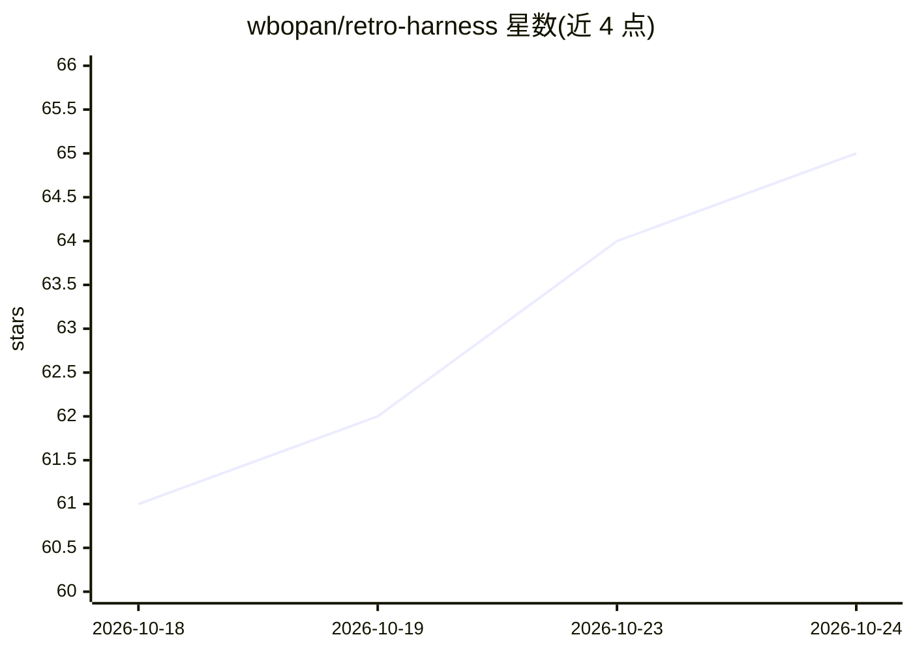

# wbopan/retro-harness

⭐ 67 · Python · MIT · 推送 2026-06-12 · [GitHub](https://github.com/wbopan/retro-harness) · [官网](https://paper-rho.wenbo.io) · 组织维护 · 中文 README

**无标注优化 LLM agent 技能与工作流的研究框架**

RHO（Retrospective Harness Optimization）研究代码库：利用 agent 自身积累的无标注历史轨迹，经共核心集选取（DPP）、并行组内 rollout、候选 harness 提案与成对自偏好选择三个阶段，改进 agent 的技能/工具/工作流（harness），全程不使用真值标签或验证集。以 Codex CLI 为基础 agent，另提供 Claude Code 动态工作流与 Codex stdlib 脚本两种即用形式，复现论文基准结果需 git clone 加 uv 安装，Python 3.11+，MIT 许可。

## 筛选速览

| 维度 | 判定 | 备注 |
|---|---|---|
| AI 角色 | `ai-ecosystem` | LLM/agent 周边工具 |
| 许可风险 | `permissive` | MIT |
| 部署形态 | `None` |  |
| 模型依赖 | — | README 未给出锁定关系 |
| 硬件要求 | — | 无带数字的原话,不猜 |
| 安装摩擦 | `low` | 无编译、无系统依赖或容器化 |
| 成熟度 | — | 结构信号不足 |

## 能力要点

- DPP 共核心集选取 + 组 rollout + 成对自偏好三阶段无标注优化
- 提供 Claude Code 动态工作流与 Codex CLI 单文件脚本两种即用入口
- 组件经 typing.Protocol 解耦，选择器/策略/数据集/agent 可替换做消融
- 每次运行持久化轨迹、诊断、候选 harness、评分与报告

## 适用场景

- 研究者复现论文在 SWE-Bench Pro 等基准上的结果
- Claude Code / Codex CLI 用户从自身历史会话中改进项目 harness
- 无真值标签的部署场景下持续优化 agent 技能与工作流

## 场景标签

 · 领域:LLM Agent 优化/研究

## 证据(README 行号)

> L14: > **RHO** improves that harness **without any ground-truth labels or validation set** — it learns purely
> L100: ├── loop.py            # the RHO evolution loop (select → rollout → propose)

## 星数曲线

2026-10-18 61 → 2026-10-24 65（+4）

---
*卡片 v1 · prompt 1.4 · 生成 2026-10-24 · 置信度 high · 依据 README sha `0e01b0ef16eb` · [字段定义](../../DATASET.md)*
