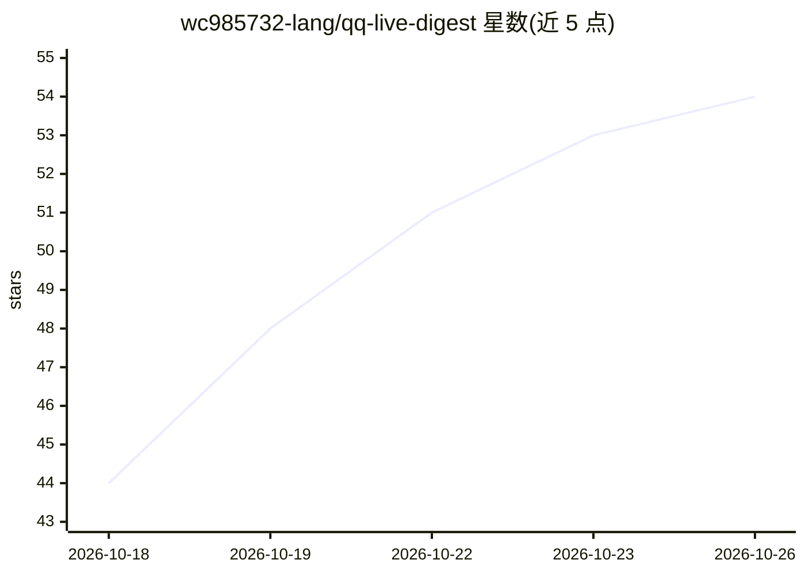

# wc985732-lang/qq-live-digest

⭐ 54 · Python · MIT · 推送 2026-10-15 · [GitHub](https://github.com/wc985732-lang/qq-live-digest) · 个人维护 · 中文 README

**QQ 群消息 AI 摘要与待办提取推送工具，配手机待办台**

通过 NapCat（OneBot v11）只读接收白名单 QQ 群消息，在本地用规则加可选 LLM（阿里云百炼或 OpenAI 兼容端点）过滤闲聊、提取通知/待办/截止时间，生成摘要后经 WxPusher、Server酱、Telegram 等多通道推送到微信等端；附带移动端待办台 PWA、日历导出、MCP 接口、决策日志与评测基线。模型层可替换，未配 API key 时回退本地规则摘要。面向 Windows 10/11 + Python 3.12 环境，从源码运行，需自备 NapCat 与至少一个推送通道。

## 筛选速览

| 维度 | 判定 | 备注 |
|---|---|---|
| AI 角色 | `ai-native` | 本体是模型或模型工具 |
| 许可风险 | `permissive` | MIT |
| 部署形态 | `desktop` | 安装包/桌面程序 |
| 模型依赖 | local-ok | 支持本地模型 |
| 硬件要求 | — | 无带数字的原话,不猜 |
| 安装摩擦 | `low` | 无编译、无系统依赖或容器化 |
| 成熟度 | — | 结构信号不足 |

## 能力要点

- 本地规则 + 可选 LLM 的分级筛选、待办与截止时间提取
- 10 种推送通道（WxPusher/Server酱/Telegram/Discord 等）与失败自动回退
- 移动端待办台 PWA、iCalendar 导出、截止提醒
- 置信度打分、决策日志、脱敏评测集基线（召回 100%）与 simulate 假群回放

## 适用场景

- 班级群/通知群太多，只想收到明确通知和待办
- 把群里的作业、考试安排自动转成待办并到期提醒
- 低置信度候选先人工确认再转正式待办

## 场景标签

`工作流自动化` · 领域:效率与自动化

## 证据(README 行号)

> L3: 通过 NapCat(OneBot v11) 只读接收指定 QQ 群的新消息，自动过滤闲聊、提取通知/待办/截止时间，
> L37: |`qq_digest.py`|本地筛选/摘要引擎（规则 + 可选百炼 LLM）|
> L314: 在 `.env` 填入阿里云百炼的 `DASHSCOPE_API_KEY`，保持 `QQ_DIGEST_LLM=1`。推送会调用

## 星数曲线

2026-10-18 44 → 2026-10-26 54（+10）

---
*卡片 v1 · prompt 1.4 · 生成 2026-10-24 · 置信度 high · 依据 README sha `8b58c0910b27` · [字段定义](../../DATASET.md)*
