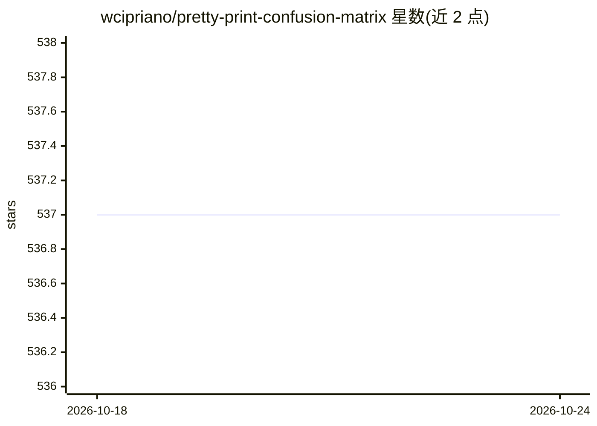

# wcipriano/pretty-print-confusion-matrix

⭐ 537 · Python · Apache-2.0 · 推送 2026-07-21 · [GitHub](https://github.com/wcipriano/pretty-print-confusion-matrix) · [官网](https://pypi.org/project/pretty-confusion-matrix/) · 个人维护

**用 seaborn/matplotlib 绘制 Matlab 风格混淆矩阵的 Python 库**

提供混淆矩阵可视化模块：读取 NumPy 矩阵或 y_test/predictions 两个数组，基于 seaborn 与 matplotlib 生成 Matlab 风格的图像，支持 DataFrame 与向量两种输入。可自定义坐标轴标签（字符串替代整数类编号）、通过 cmap 参数选择配色方案（PuRd、Oranges 等）。面向需要在分类模型评估中生成可视化图表的 Python 开发者，以 pip 包形式分发。

## 筛选速览

| 维度 | 判定 | 备注 |
|---|---|---|
| AI 角色 | `ai-ecosystem` | LLM/agent 周边工具 |
| 许可风险 | `permissive` | Apache-2.0 |
| 部署形态 | `library` | 以包/库形式分发 |
| 模型依赖 | — | README 未给出锁定关系 |
| 硬件要求 | — | 无带数字的原话,不猜 |
| 安装摩擦 | `low` | 无编译、无系统依赖或容器化 |
| 成熟度 | — | 结构信号不足 |

## 能力要点

- 从 NumPy 矩阵或 y_test/predictions 数组生成混淆矩阵图
- 支持 DataFrame 与向量两种输入方式
- 自定义坐标轴标签（如 Dog/Cat/Mouse 替代整数）
- 通过 cmap 参数选择多种配色方案

## 适用场景

- 为分类模型评估结果生成可读的混淆矩阵图
- 用自定义类别标签替换整数编号展示矩阵
- 在报告中选择不同配色方案美化矩阵展示

## 场景标签

 · 领域:机器学习评估/可视化

## 证据(README 行号)

> L14: Plot a pretty confusion matrix (like Matlab) in python using seaborn and matplotlib.
> L16: This module get a pretty print confusion matrix from a NumPy matrix or from 2 NumPy arrays (`y_test` and `predictio

## 星数曲线

2026-10-18 537 → 2026-10-24 537（+0）

---
*卡片 v1 · prompt 1.4 · 生成 2026-10-21 · 置信度 high · 依据 README sha `da5d1d75764d` · [字段定义](../../DATASET.md)*
