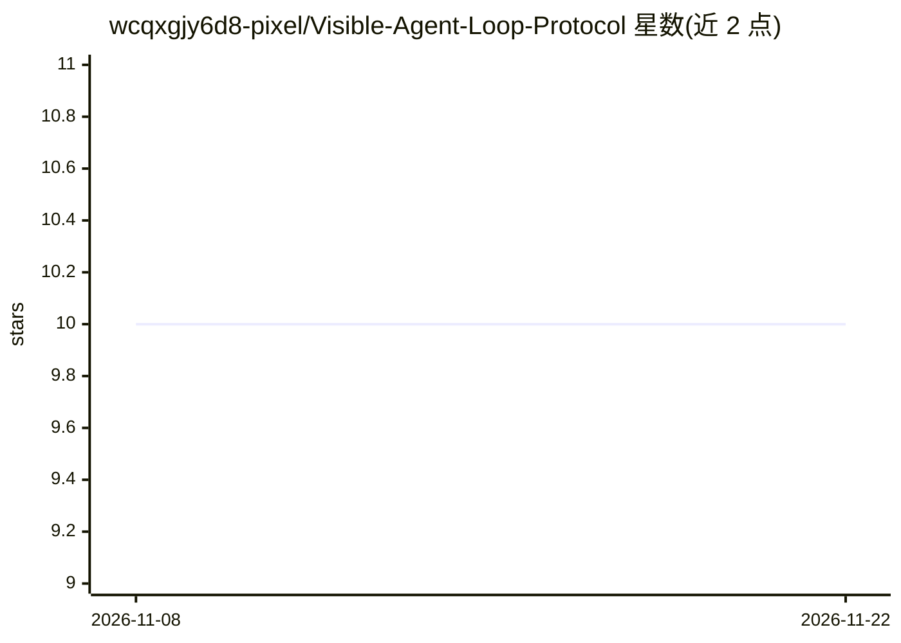

# wcqxgjy6d8-pixel/Visible-Agent-Loop-Protocol

⭐ 10 · Python · MIT · 推送 2026-09-01 · [GitHub](https://github.com/wcqxgjy6d8-pixel/Visible-Agent-Loop-Protocol) · [官网](https://wcqxgjy6d8-pixel.github.io/Visible-Agent-Loop-Protocol/) · 个人维护 · 中文 README

**面向个人与团队的多 agent 执行审计协议与 CLI：为完成声明提供证据**

VALP（Visible Agent Loop Protocol）是一个开放协议及配套的 valp 参考命令行工具，用于让自主/多 agent 工作过程可见、可核查：通过调度回执、预期证据、审查/批准门、最终综合与任务级学习反馈来捕获虚假的"已完成"声明。面向个人经营者（一人公司）、团队企业与 runtime 开发者。协议不绑定单一模型提供商或终端；HERDR 是当前参考 runtime，但协议本身不依赖它。仓库自述为 v0.3.0，MIT 许可，非托管平台、不宜描述为生产就绪。

## 筛选速览

| 维度 | 判定 | 备注 |
|---|---|---|
| AI 角色 | `ai-ecosystem` | LLM/agent 周边工具 |
| 许可风险 | `permissive` | MIT |
| 部署形态 | `library` | 以包/库形式分发 |
| 模型依赖 | — | README 未给出锁定关系 |
| 硬件要求 | — | 无带数字的原话,不猜 |
| 安装摩擦 | `low` | 无编译、无系统依赖或容器化 |
| 成熟度 | — | 结构信号不足 |

## 能力要点

- valp audit 强制回执、证据、自动化策略、审查与批准等完成门
- 用户选定 Installation Leader，能力注册表分层记录声明与实测
- 任务图（Task Graph）为只读投影，不产生或变更审计状态
- 提供中英双语文档入口与可复现的示例审计路径

## 适用场景

- 让一个 agent 干活、另一个 agent 核查，并对完成声明做审计
- 为多人/多 agent 协作流程建立从指派到审批的可追溯链路
- 为自研 agent runtime 实现符合 VALP 语义的回执与证据导出

## 场景标签

`多智能体` · 领域:Agent 开发

## 证据(README 行号)

> L29: VALP is an open protocol and reference CLI for visible, evidence-backed
> L68: The protocol is designed for terminal-based AI coding agents, review agents,
> L104: VALP `v0.3.0` is the published protocol release and MIT-licensed reference CLI.

## 星数曲线

2026-11-08 10 → 2026-11-22 10（+0）

---
*卡片 v1 · prompt 1.4 · 生成 2026-11-19 · 置信度 mid · 依据 README sha `51fd61827155` · [字段定义](../../DATASET.md)*
