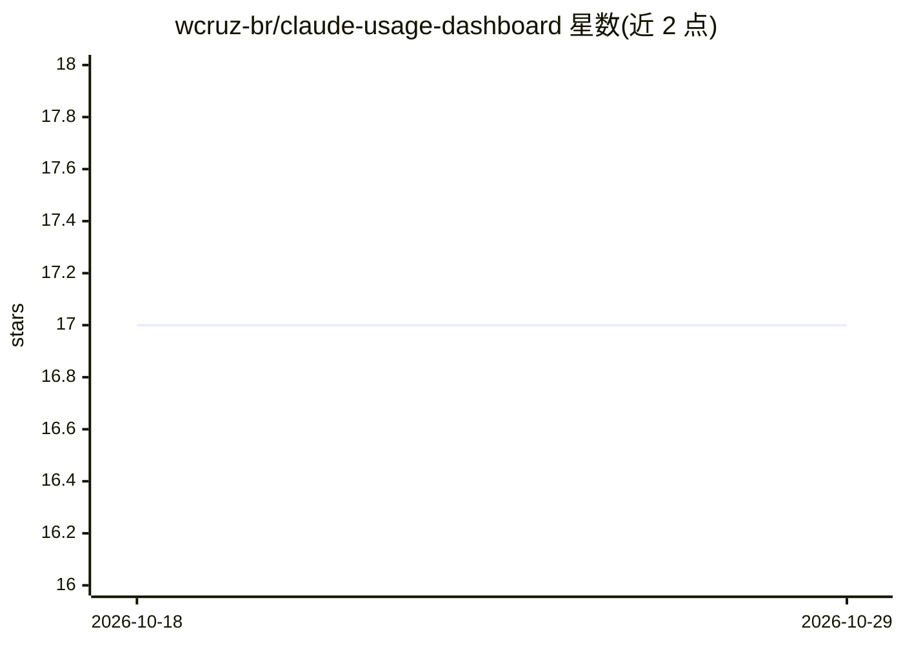

# wcruz-br/claude-usage-dashboard

⭐ 17 · Python · 推送 2026-04-24 · [GitHub](https://github.com/wcruz-br/claude-usage-dashboard) · 个人维护

**终端实时监控 Claude Code 用量的 Python 脚本**

单文件 Python 脚本，面向 Claude Code Pro/Max 订阅用户，读取本地 ~/.claude/.credentials.json 凭据，调用 Anthropic OAuth usage 接口，以终端进度条展示 5 小时与 7 天配额利用率，每 5 分钟自动刷新，按利用率变色（绿/黄/红）。无外部依赖，git clone 后直接 python 运行，配置仅通过脚本内常量调整。依赖一个未公开文档化的 API 端点，README 声明其可能随时变更，并给出备选工具 ccusage。

## 筛选速览

| 维度 | 判定 | 备注 |
|---|---|---|
| AI 角色 | `ai-ecosystem` | LLM/agent 周边工具 |
| 许可风险 | `none` | — |
| 部署形态 | `None` |  |
| 模型依赖 | locked-api |  |
| 硬件要求 | — | 无带数字的原话,不猜 |
| 安装摩擦 | `low` | 无编译、无系统依赖或容器化 |
| 成熟度 | — | 结构信号不足 |

## 能力要点

- 读取本地凭据调用 Anthropic OAuth usage 接口获取利用率
- 5 小时与 7 天两种配额窗口的终端进度条展示
- 无外部依赖，单文件直接运行
- 每 300 秒自动刷新，按利用率阈值变色

## 适用场景

- Claude Code Pro/Max 用户实时查看配额消耗
- 在接近限流前掌握 5 小时窗口利用率
- 在终端常驻监控用量避免切换网页

## 场景标签

 · 领域:开发者工具/AI 用量监控

## 证据(README 行号)

> L3: Real-time Claude Code usage monitor for the terminal (Pro/Max plans).
> L55: The script queries `GET https://api.anthropic.com/api/oauth/usage` with the header `anthropic-beta: oauth-2025-04-2

## 星数曲线

2026-10-18 17 → 2026-10-29 17（+0）

---
*卡片 v1 · prompt 1.4 · 生成 2026-10-29 · 置信度 high · 依据 README sha `4df6a0c88f5a` · [字段定义](../../DATASET.md)*
