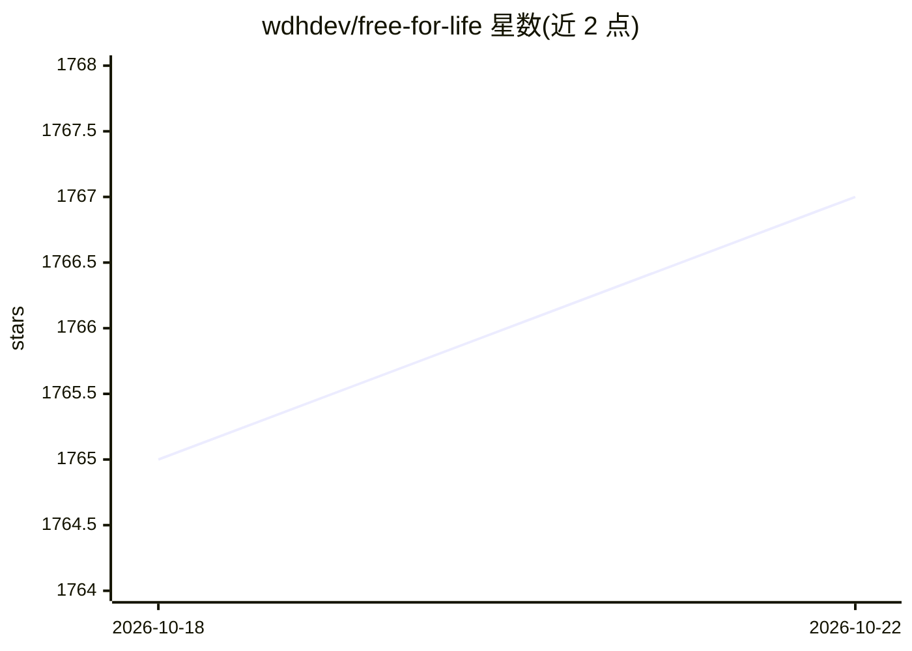

# wdhdev/free-for-life

⭐ 1,769 · HTML · MIT · 推送 2026-10-10 · [GitHub](https://github.com/wdhdev/free-for-life) · [官网](https://free.hrsn.dev/) · 个人维护

**免费 SaaS/API/AI 等互联网服务与工具的策展清单**

awesome 类免费资源目录，按类别收录长期免费或带免费额度的服务，覆盖 APIs/数据/ML、人工智能、BaaS 等多类。条目为服务名加免费额度与功能描述的表格，面向开发者与个人用户查找免费可用资源。清单本身不含代码，无安装运行流程，维护方式为社区贡献。

## 筛选速览

| 维度 | 判定 | 备注 |
|---|---|---|
| AI 角色 | `ai-knowledge` | 知识聚合/清单类 |
| 许可风险 | `permissive` | MIT |
| 部署形态 | `None` |  |
| 模型依赖 | — | README 未给出锁定关系 |
| 硬件要求 | — | 无带数字的原话,不猜 |
| 安装摩擦 | `low` | 无编译、无系统依赖或容器化 |
| 成熟度 | — | 结构信号不足 |

## 能力要点

- 按类别（APIs/数据/ML、AI、BaaS 等）组织的免费服务表格
- 条目标注免费额度（请求次数/存储/运行时长等）
- 社区贡献维护的策展清单

## 适用场景

- 为项目寻找带免费额度的 API 或后端服务
- 查找可免费使用的 AI 工具与模型平台
- 比较各类 SaaS 的免费套餐限制

## 场景标签

`精选清单` · 领域:学习与行业

## 证据(README 行号)

> L1: # 💸 Free For Life
> L10: ## APIs, Data and ML

## 星数曲线

2026-10-18 1,765 → 2026-10-22 1,767（+2）

---
*卡片 v1 · prompt 1.4 · 生成 2026-10-21 · 置信度 high · 依据 README sha `ea134a595c05` · [字段定义](../../DATASET.md)*
