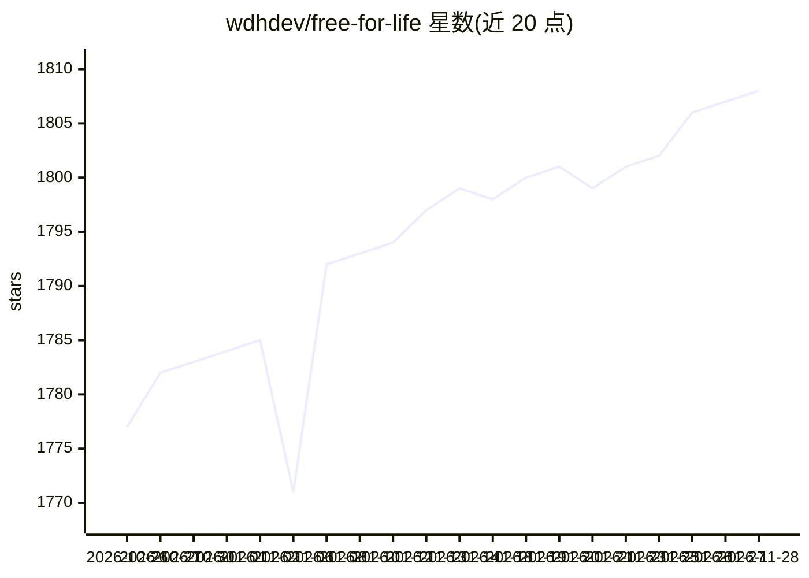

# wdhdev/free-for-life

⭐ 1,808 · HTML · MIT · 推送 2026-11-04 · [GitHub](https://github.com/wdhdev/free-for-life) · [官网](https://free.hrsn.dev/) · 个人维护

**面向开发者与普通用户的免费服务聚合清单**

以 awesome-list 形式编目可长期免费获取的服务资源，按类别分节（可见部分为 APIs/Data/ML 与 Artificial Intelligence 等），每条列出服务名称、描述与免费额度（如每月调用次数、免费积分、是否需信用卡）。收录对象为第三方商业或社区服务，本仓库自身不提供安装包或代码，仅维护目录条目并接受社区贡献。

## 筛选速览

| 维度 | 判定 | 备注 |
|---|---|---|
| AI 角色 | `ai-knowledge` | 知识聚合/清单类 |
| 许可风险 | `permissive` | MIT |
| 部署形态 | `None` |  |
| 模型依赖 | — | README 未给出锁定关系 |
| 硬件要求 | — | 无带数字的原话,不猜 |
| 安装摩擦 | `low` | 无编译、无系统依赖或容器化 |
| 成熟度 | — | 结构信号不足 |

## 能力要点

- 按类别组织的服务清单，标注各家免费额度与限制
- 收录 AI 聊天/生成类服务与 API/数据/ML 平台两类资源
- 接受社区贡献（Contribute 入口）

## 适用场景

- 开发者为个人项目寻找有免费层级的 API 与数据服务
- 查找可免费使用的 AI 聊天与图像生成服务
- 比较同类服务的免费额度后再选型

## 场景标签

`精选清单` · 领域:学习与行业

## 证据(README 行号)

> L2: A huge list of great stuff you can get for free!
> L10: ## APIs, Data and ML
> L73: ## Artificial Intelligence

## 星数曲线

2026-10-26 1,777 → 2026-11-28 1,808（+31）

---
*卡片 v1 · prompt 1.4 · 生成 2026-11-23 · 置信度 high · 依据 README sha `0418120dd6b2` · [字段定义](../../DATASET.md)*
