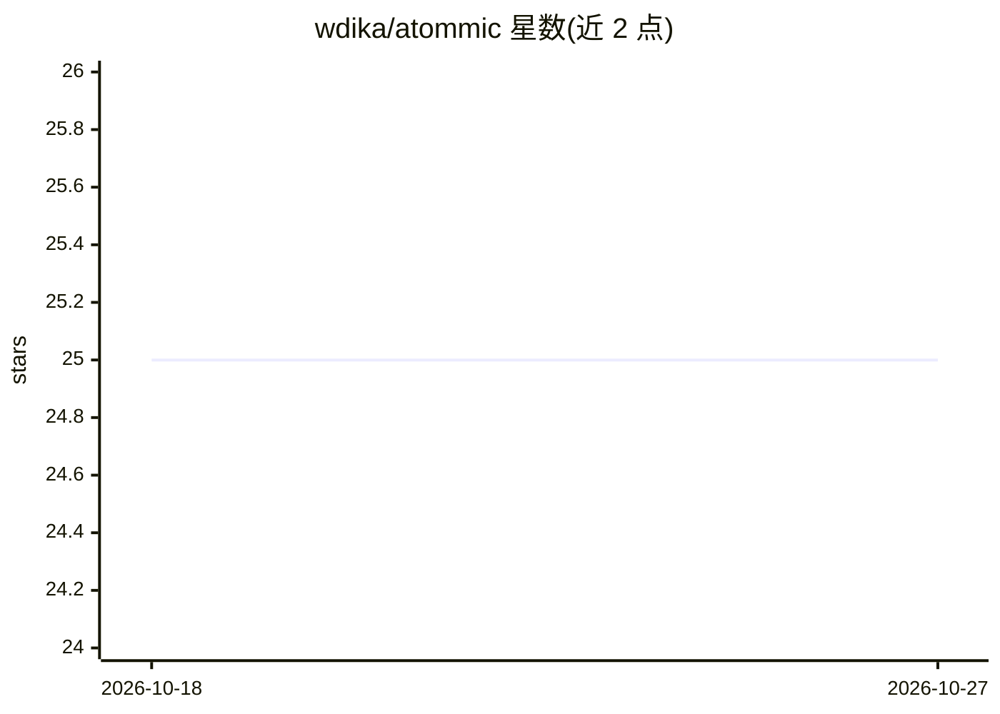

# wdika/atommic

⭐ 25 · Jupyter Notebook · Apache-2.0 · 推送 2026-03-04 · [GitHub](https://github.com/wdika/atommic) · [官网](https://atommic.readthedocs.io) · 个人维护

**MRI 多任务深度学习工具箱：重建、分割、定量成像统一框架**

面向医学影像研究者的 MRI 深度学习工具箱，覆盖加速 MRI 重建（REC）、分割（SEG）、定量成像（qMRI）与多任务学习（MTL），各任务以 collection 形式组织，包含数据加载器、变换、模型、指标与损失。配置通过 Hydra/OmegaConf 的 .yaml 文件完成，基于 PyTorch Lightning 支持多 GPU/多节点混合精度训练；模型可导出为 ONNX/TorchScript 并上传 HuggingFace，提供预训练模型。原生支持 fastMRI、BraTS、CC359 等 9 个公开数据集。提供 pip、Docker、源码安装途径与教程。

## 筛选速览

| 维度 | 判定 | 备注 |
|---|---|---|
| AI 角色 | `ai-native` | 本体是模型或模型工具 |
| 许可风险 | `permissive` | Apache-2.0 |
| 部署形态 | `self-host` | docker 或自建部署 |
| 模型依赖 | — | README 未给出锁定关系 |
| 硬件要求 | — | 无带数字的原话,不猜 |
| 安装摩擦 | `low` | 无编译、无系统依赖或容器化 |
| 成熟度 | — | 结构信号不足 |

## 能力要点

- REC/SEG/qMRI/MTL 四类任务 40+ 模型实现，模块化可扩展
- 基于 PyTorch Lightning 的多 GPU/多节点混合精度训练
- 模型导出 ONNX/TorchScript，预训练模型托管于 HuggingFace
- 原生支持 9 个公开 MRI 数据集（fastMRI、BraTS 2023、SKM-TEA 等）

## 适用场景

- 在 fastMRI 等公开数据集上训练 MRI 重建或分割模型
- 同时执行重建与分割的多任务学习实验
- 复用预训练模型或上传自己的模型到 HuggingFace

## 场景标签

`模型训练` `图像视频处理` · 领域:感知与多模态

## 证据(README 行号)

> L22: The Advanced Toolbox for Multitask Medical Imaging Consistency (ATOMMIC) is a toolbox for applying AI methods for *
> L138: ### MRI Segmentation (SEG)
> L143: **ATOMMIC** supports public datasets, as well as private datasets. The following public datasets are supported nat

## 星数曲线

2026-10-18 25 → 2026-10-27 25（+0）

---
*卡片 v1 · prompt 1.4 · 生成 2026-10-26 · 置信度 high · 依据 README sha `3ba8fa8341b6` · [字段定义](../../DATASET.md)*
