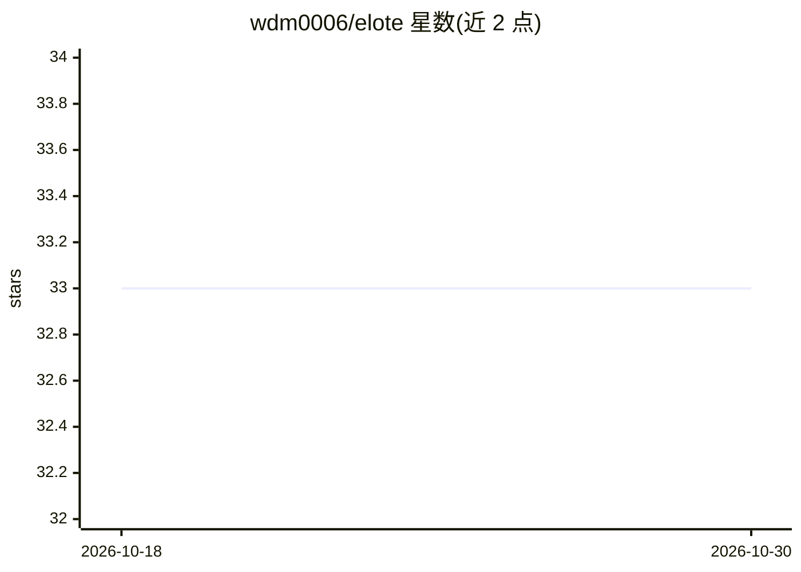

# wdm0006/elote

⭐ 33 · Python · MIT · 推送 2026-10-22 · [GitHub](https://github.com/wdm0006/elote) · [官网](https://wdm0006.github.io/elote/) · 个人维护

**统一 Python 接口下比较多种评分排序算法的库**

进程内 Python 库，将 Elo、Glicko-1/2、TrueSkill、Bradley-Terry、Colley、Massey、Keener、Whole-History 等 13 种两两比较评分模型封装在共享的 competitor 接口下：输入胜负平记录，产出期望得分、排名与排行榜。提供 LambdaArena 管理动态选手群、DataSplit 与 benchmark_competitors 在同一数据上评估不同模型，并保留 History 支持准确率、校准、Brier 分数等指标与绘图辅助。不提供 CLI、API、服务器或数据库，持久化由应用自行处理。MIT 许可，Alpha 开发阶段分类器，需 Python 3.10+。

## 筛选速览

| 维度 | 判定 | 备注 |
|---|---|---|
| AI 角色 | `ai-native` | 本体是模型或模型工具 |
| 许可风险 | `permissive` | MIT |
| 部署形态 | `library` | 以包/库形式分发 |
| 模型依赖 | — | README 未给出锁定关系 |
| 硬件要求 | — | 无带数字的原话,不猜 |
| 安装摩擦 | `low` | 无编译、无系统依赖或容器化 |
| 成熟度 | `idea` | |

## 能力要点

- 13 种评分模型共享统一 competitor 工作流，可替换比较
- LambdaArena 管理动态选手群并输出排行榜
- DataSplit/benchmark 在留出数据上比较模型，含准确率、Brier、log loss
- 状态序列化（export_state/to_json）与恢复

## 适用场景

- 我有对战/胜负记录，想给选手或队伍评分排名
- 在同一比赛历史上比较 Elo、Glicko、TrueSkill 等模型哪个拟合
- 游戏匹配或竞赛系统需要持续更新 ratings 并可保存恢复

## 场景标签

 · 领域:机器学习/评分排序算法

## 证据(README 行号)

> L7: **The scikit-learn of rating algorithms: compare rating models behind one
> L65: Every row below is exported from `elote` and supports the shared competitor
> L91: Elote keeps pre-result predictions in `History` objects so you can inspect

## 星数曲线

2026-10-18 33 → 2026-10-30 33（+0）

---
*卡片 v1 · prompt 1.4 · 生成 2026-10-25 · 置信度 high · 依据 README sha `93f289e002ae` · [字段定义](../../DATASET.md)*
