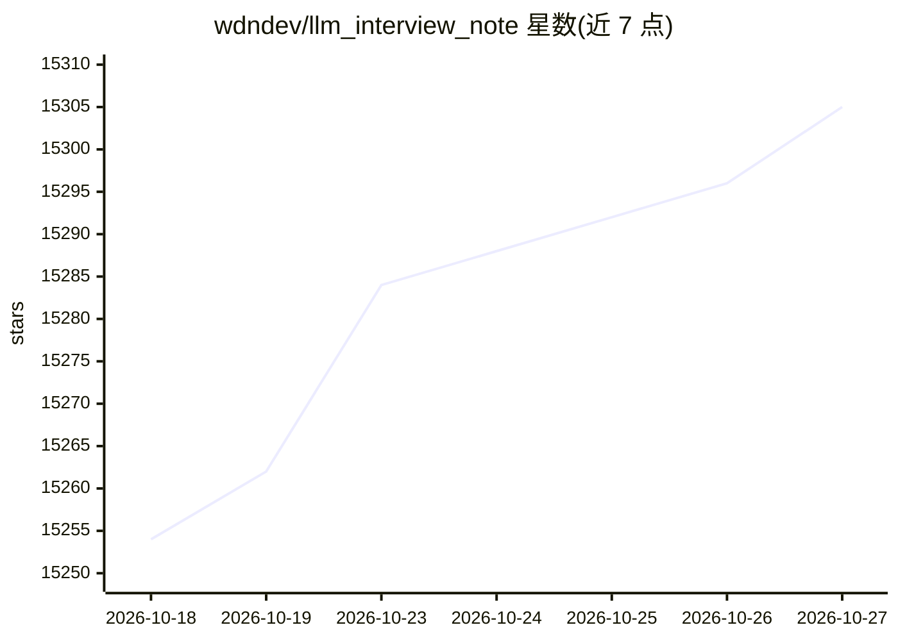

# wdndev/llm_interview_note

⭐ 15,305 · HTML · 推送 2026-06-14 · [GitHub](https://github.com/wdndev/llm_interview_note) · [官网](https://wdndev.github.io/llm_interview_note) · 个人维护 · 中文 README

**大模型算法工程师的知识整理与面试题笔记**

以个人笔记形式整理大语言模型相关知识及面试题，内容参考网络资源汇编，答案为作者自行撰写并欢迎修正，提供在线阅读链接，另附微信公众号作为更新渠道。仓库同时推荐作者的其他动手实践项目（tiny-llm-zh、tiny-rag、tiny-mcp、llama3-from-scratch-zh）及 AI 工程师八股等学习资源。适合准备大模型方向岗位面试的读者阅读。

## 筛选速览

| 维度 | 判定 | 备注 |
|---|---|---|
| AI 角色 | `ai-knowledge` | 知识聚合/清单类 |
| 许可风险 | `none` | — |
| 部署形态 | `None` |  |
| 模型依赖 | — | README 未给出锁定关系 |
| 硬件要求 | — | 无带数字的原话,不猜 |
| 安装摩擦 | `low` | 无编译、无系统依赖或容器化 |
| 成熟度 | — | 结构信号不足 |

## 动量与使用信号

- 维护:`maintenance` — 距上次 push 125.7 天,年发版 0,8 位贡献者
- 涨星:近 1 天 **+5**(自 20261016 起算)
- 平台:— · 协议:MCP

## 能力要点

- 覆盖 LLM 算法（应用）工程师相关知识及面试题
- 提供在线阅读链接
- 附带 tiny-llm-zh、tiny-rag、tiny-mcp 等配套实践项目
- llama3-from-scratch-zh 可在 16G 内存本地笔记本运行

## 适用场景

- 准备大模型算法/应用工程师岗位面试
- 系统梳理 LLM 相关概念知识点
- 通过配套小项目动手学习预训练、微调、RAG、MCP

## 场景标签

`教程课程` · 领域:学习与行业

## 证据(README 行号)

> L1: # LLMs 相关知识及面试题
> L5: 本仓库为大模型面试相关概念，由本人参考网络资源整理，欢迎阅读，如果对你有用，麻烦点一下 `🌟 star`，谢谢！
> L21: 在线阅读链接：LLMs Interview Note

## 星数曲线

2026-10-18 15,254 → 2026-10-27 15,305（+51）

---
*卡片 v1 · prompt 1.4 · 生成 2026-10-18 · 置信度 high · 依据 README sha `1152e8dc8e4c` · [字段定义](../../DATASET.md)*
