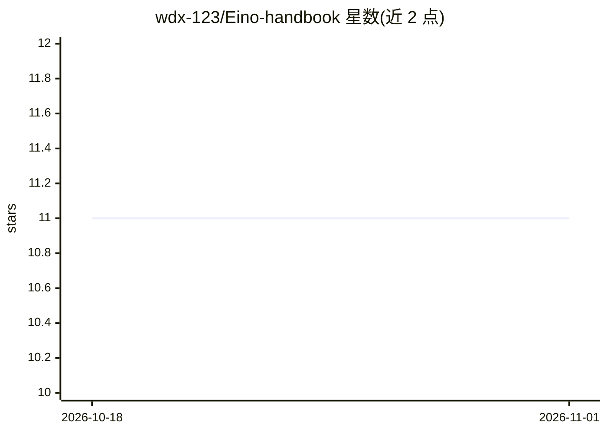

# wdx-123/Eino-handbook

⭐ 11 · PowerShell · Apache-2.0 · 推送 2026-04-20 · [GitHub](https://github.com/wdx-123/Eino-handbook) · [官网](https://blog.csdn.net/2302_80067378/category_13132166.html) · 个人维护 · 中文 README

**面向中文开发者的 CloudWeGo Eino 教程学习手册**

改编自官方 Eino 教程的中文学习仓库，由 19 篇正文、1 篇总纲和 5 个可运行 Go demo 组成，按前置基础、入门必学、组件核心、编排进阶、ADK 体系五段主线组织，覆盖 ChatModel、Tool、Memory、Callback、Chain/Graph/Workflow 等主题。面向初次接触 Eino、想系统学习并做 AI Agent 的 Go 开发者，同时提供适合面试与技术分享的四层表达框架。仓库持续更新，欢迎 Issues 与 PR。

## 筛选速览

| 维度 | 判定 | 备注 |
|---|---|---|
| AI 角色 | `ai-knowledge` | 知识聚合/清单类 |
| 许可风险 | `permissive` | Apache-2.0 |
| 部署形态 | `None` |  |
| 模型依赖 | — | README 未给出锁定关系 |
| 硬件要求 | — | 无带数字的原话,不猜 |
| 安装摩擦 | `low` | 无编译、无系统依赖或容器化 |
| 成熟度 | — | 结构信号不足 |

## 能力要点

- 19 篇正文 + 1 篇总纲 + 5 个可运行 Go demo
- 五段主线：前置基础 -> 入门必学 -> 组件核心 -> 编排进阶 -> ADK 体系
- chatmodel-message 到 chain-graph 的 5 个示例（其中 chain-graph 零 API Key 可跑）
- 提供面试展示用的四层表达框架

## 适用场景

- 系统学习 CloudWeGo Eino 框架而非零散看 API
- 跑通可运行示例验证 ChatModel、Tool、编排等概念
- 准备 AI Agent 相关面试展示或团队内部分享

## 场景标签

`教程课程` · 领域:学习与行业

## 证据(README 行号)

> L5: 面向中文开发者的 CloudWeGo Eino 学习仓，提供系统教程、可运行 Go 示例，以及适合面试与技术分享的表达框架。
> L8: 由 `19 篇正文 + 1 篇总纲 + 5 个可运行 demo` 组成。

## 星数曲线

2026-10-18 11 → 2026-11-01 11（+0）

---
*卡片 v1 · prompt 1.4 · 生成 2026-11-01 · 置信度 high · 依据 README sha `6b451da7bbc6` · [字段定义](../../DATASET.md)*
