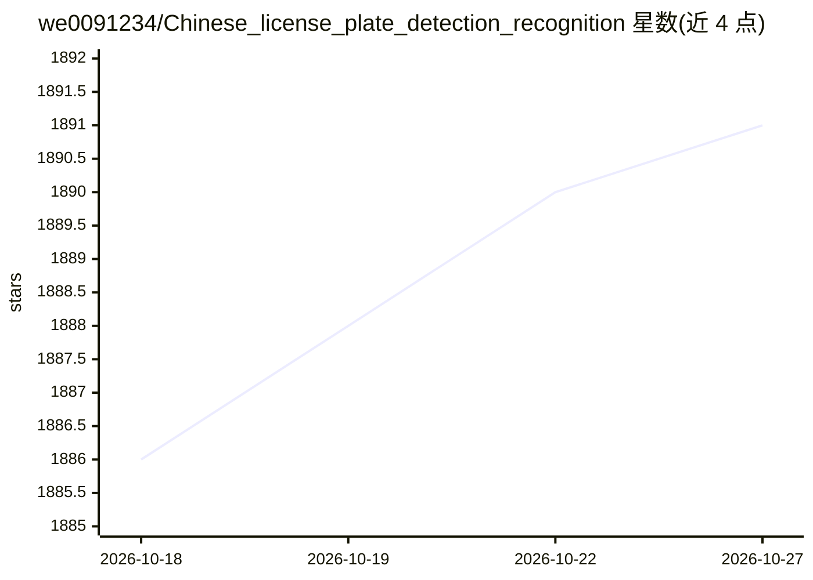

# we0091234/Chinese_license_plate_detection_recognition

⭐ 1,891 · Python · GPL-3.0 · 推送 2026-06-05 · [GitHub](https://github.com/we0091234/Chinese_license_plate_detection_recognition) · 个人维护 · 中文 README

**基于 YOLOv5 的中文车牌检测与识别工具，支持 12 种车牌**

基于 YOLOv5 的车牌检测与 CRNN 识别的 PyTorch 实现：先检测车牌位置，再识别车牌字符与颜色，支持单行蓝牌、新能源、双层车牌等 12 种中文车牌类型，可处理图片与视频。提供训练入口（链接到外部文档）与多种部署路径：NCNN 安卓、ONNX、TensorRT、OpenVINO。环境要求 python>=3.6、pytorch>=1.7。README 提供模型训练与商务合作的微信联系方式及代做毕设说明。

## 筛选速览

| 维度 | 判定 | 备注 |
|---|---|---|
| AI 角色 | `ai-native` | 本体是模型或模型工具 |
| 许可风险 | `viral` | GPL-3.0 |
| 部署形态 | `None` |  |
| 模型依赖 | — | README 未给出锁定关系 |
| 硬件要求 | — | 无带数字的原话,不猜 |
| 安装摩擦 | `low` | 无编译、无系统依赖或容器化 |
| 成熟度 | — | 结构信号不足 |

## 能力要点

- YOLOv5 车牌检测 + 车牌字符识别两阶段流水线
- 支持 12 种中文车牌类型，含双层车牌与新能源车牌
- 支持图片与视频推理
- 提供 NCNN/ONNX/TensorRT/OpenVINO 部署路径

## 适用场景

- 对图片或视频中的中文车牌做检测与识别
- 将车牌识别模型部署到安卓或边缘推理框架
- 训练自己数据集上的车牌检测/识别模型

## 场景标签

`目标检测` · 领域:感知与多模态

## 证据(README 行号)

> L10: ## **最全车牌识别算法，支持12种中文车牌类型**
> L19: python detect_plate.py --detect_model weights/plate_detect.pt  --rec_model weights/plate_rec_color.pth --image_path

## 星数曲线

2026-10-18 1,886 → 2026-10-27 1,891（+5）

---
*卡片 v1 · prompt 1.4 · 生成 2026-10-21 · 置信度 high · 依据 README sha `32b97709d648` · [字段定义](../../DATASET.md)*
