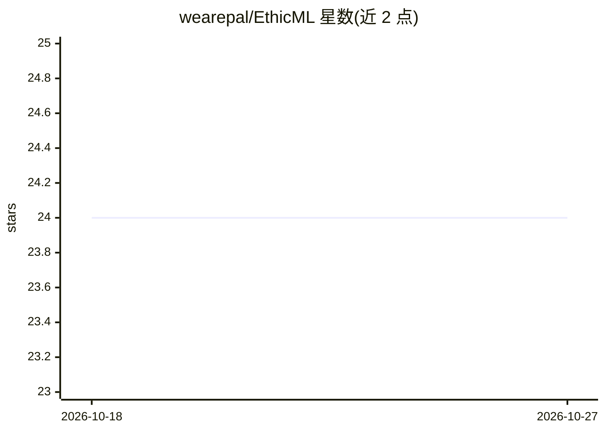

# wearepal/EthicML

⭐ 24 · Python · GPL-3.0 · 推送 2026-04-05 · [GitHub](https://github.com/wearepal/EthicML) · [官网](https://wearepal.ai/EthicML/) · 组织维护

**算法公平性评估与研究工具库**

面向研究者的算法公平性 Python 库，提供数据、算法、度量分离的框架：以 {x, s, y} 三元组（特征/敏感属性/类别标签）为基础的 DataTuple/TestTuple 结构，将预处理、训练中、后处理方法按接口分离，经 evaluate_models 汇入多种公平性度量。支持多个敏感属性与视觉数据集，结果可复现。需 Python>=3.8，PyTorch 需另行安装方可使用全部功能。自称非教学工具而是研究工具箱，并称在适当处吸收了部分同类库。

## 筛选速览

| 维度 | 判定 | 备注 |
|---|---|---|
| AI 角色 | `ai-ecosystem` | LLM/agent 周边工具 |
| 许可风险 | `viral` | GPL-3.0 |
| 部署形态 | `library` | 以包/库形式分发 |
| 模型依赖 | — | README 未给出锁定关系 |
| 硬件要求 | — | 无带数字的原话,不猜 |
| 安装摩擦 | `low` | 无编译、无系统依赖或容器化 |
| 成熟度 | `idea` | |

## 能力要点

- 以 {x, s, y} 三元组为核心的数据结构设计
- pre/in/post 三段算法接口分离
- 支持多个敏感属性与视觉数据集
- 代码经 mypy 类型检查与测试，结果可复现

## 适用场景

- 研究者评估与比较公平性方法
- 在训练前/中/后各阶段组合公平性方法
- 生成可复现的公平性实验结果

## 场景标签

`模型评测` · 领域:评测与运维

## 证据(README 行号)

> L5: EthicML is a library for performing and assessing __algorithmic fairness__.
> L6: Unlike other libraries, EthicML isn't an education tool, but rather a __researcher__'s toolkit.
> L15: Because of this, we built EthicML, a fairness toolkit for researchers.

## 星数曲线

2026-10-18 24 → 2026-10-27 24（+0）

---
*卡片 v1 · prompt 1.4 · 生成 2026-10-27 · 置信度 high · 依据 README sha `c73440c46b42` · [字段定义](../../DATASET.md)*
