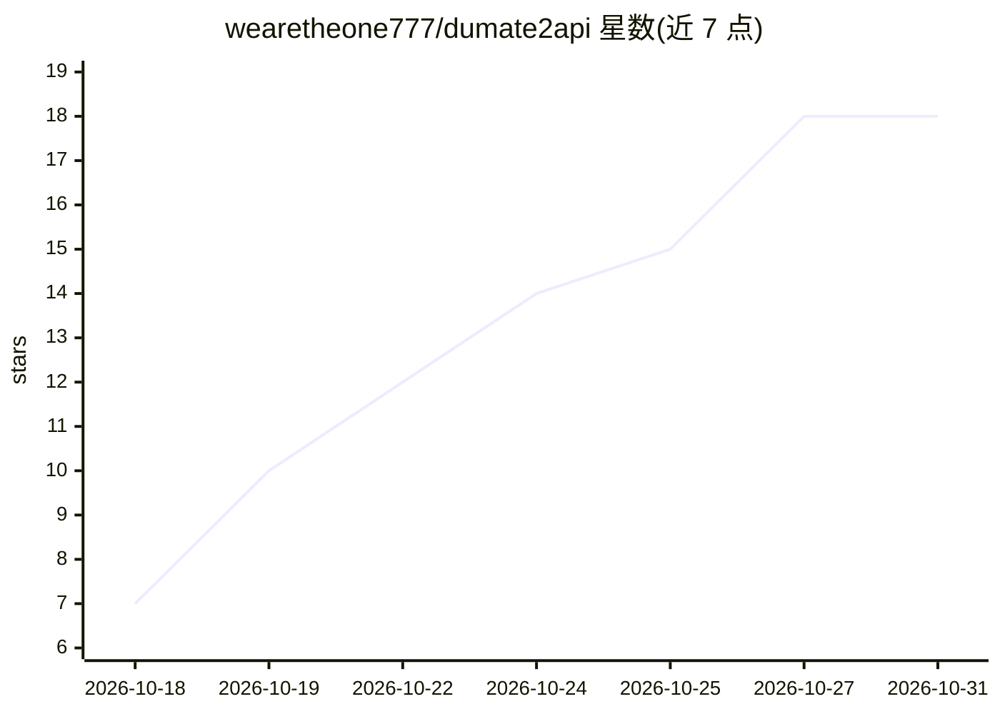

# wearetheone777/dumate2api

⭐ 18 · JavaScript · MIT · 推送 2026-10-30 · [GitHub](https://github.com/wearetheone777/dumate2api) · [官网](https://github.com/wearetheone777/dumate2api#readme) · 个人维护 · 中文 README

**把四个国内上游转成三协议 OpenAI 兼容网关，供 CLI 编程客户端使用**

Node.js 实现的 API 网关：将百度搭子（DuMate）、千问办公、TRAE Work、Qoder 四条上游统一转换为 OpenAI / Anthropic / Google 三种兼容协议端点，供 Codex CLI、Claude Code、cc-switch 等客户端调用。凭证自持（网页 cookie / OAuth Device Flow），千问与 Qoder 签名为纯本地实现，不需官方客户端；网关只用 Node 内置模块。附带网页管理端，覆盖账号、签到、积分、用量与请求日志。通过模型名前缀显式路由，未知前缀返回 400；API Key 校验默认关闭，对外暴露需手动开启；网页账号 cookie 以明文存储。

## 筛选速览

| 维度 | 判定 | 备注 |
|---|---|---|
| AI 角色 | `ai-ecosystem` | LLM/agent 周边工具 |
| 许可风险 | `permissive` | MIT |
| 部署形态 | `library` | 以包/库形式分发 |
| 模型依赖 | — | README 未给出锁定关系 |
| 硬件要求 | — | 无带数字的原话,不猜 |
| 安装摩擦 | `low` | 无编译、无系统依赖或容器化 |
| 成熟度 | — | 结构信号不足 |

## 能力要点

- OpenAI / Anthropic / Google 三协议端点，含 Codex CLI 的 responses 线格式
- 四通道模型名前缀分流，未知前缀 400 不静默回落
- 千问与 Qoder 凭证签名纯本地实现，零官方客户端依赖
- 网页管理端：签到、积分明细（按月/按年）、用量统计、请求日志

## 适用场景

- 让 Codex CLI / Claude Code 等客户端直接调用百度搭子、千问办公等国内上游
- 统一管理多账号的签到与积分消耗
- 本地转发并查看逐条请求的用量与积分开销

## 场景标签

`模型网关` · 领域:Agent 开发

## 证据(README 行号)

> L10: **四条上游 → 三协议网关。** 把百度搭子（DuMate）、千问办公、TRAE Work、Qoder 统一转成 **OpenAI / Anthropic / Google 兼容 API**，供 Codex CLI、Claude
> L16: Claude Code ──── Anthropic ────────┼──→ dumate2api ──┬──→ 百度搭子（网页凭证 / 本地 :8980）
> L36: npm start                  # 网关 http://127.0.0.1:9080

## 星数曲线

2026-10-18 7 → 2026-10-31 18（+11）

---
*卡片 v1 · prompt 1.4 · 生成 2026-10-29 · 置信度 high · 依据 README sha `dd800148bf4d` · [字段定义](../../DATASET.md)*
