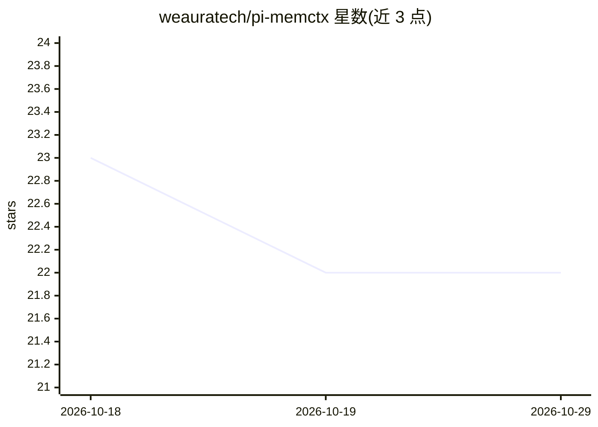

# weauratech/pi-memctx

⭐ 22 · TypeScript · MIT · 推送 2026-10-15 · [GitHub](https://github.com/weauratech/pi-memctx) · [官网](https://weauratech.github.io/pi-memctx) · 组织维护

**给 Pi 编程代理的本地 Markdown 记忆层扩展**

作为 Pi coding agent 的扩展安装的 Memory Gateway：每次提示前先检索本地项目记忆，注入压缩后的相关上下文；轮次结束后自动学习持久化发现，生成带 wikilinks 交叉链接的 Markdown 笔记（context/decision/observation/runbook 等），不确定的候选进入人工审查队列。记忆为本地 Markdown 文件，可用任意编辑器编辑、提交、grep，无需托管向量数据库；记忆不足时回退到常规仓库检查。检索后端优先使用 qmd，缺失时回退 grep。以 npm 包或 GitHub 源码方式安装。

## 筛选速览

| 维度 | 判定 | 备注 |
|---|---|---|
| AI 角色 | `ai-ecosystem` | LLM/agent 周边工具 |
| 许可风险 | `permissive` | MIT |
| 部署形态 | `library` | 以包/库形式分发 |
| 模型依赖 | — | README 未给出锁定关系 |
| 硬件要求 | — | 无带数字的原话,不猜 |
| 安装摩擦 | `low` | 无编译、无系统依赖或容器化 |
| 成熟度 | — | 结构信号不足 |

## 能力要点

- 提示前注入项目记忆，轮次后自动学习多条交叉链接的 Markdown 笔记
- 记忆为本地 Markdown pack，可读/编辑/提交/版本化，无需托管向量数据库
- 疑似密钥内容在持久化前被拦截/脱敏
- 检索后端 qmd 优先，缺失时回退 grep，可选 keyword/semantic/deep 搜索模式

## 适用场景

- 大型仓库或 monorepo 中避免代理每次会话重新摸索架构与部署流程
- 团队希望代理记忆本地化、可审查、可版本管理
- 把规划/探索会话沉淀为可复用的项目 runbook 与决策笔记

## 场景标签

`Agent 记忆` `知识库管理` · 领域:Agent 开发

## 证据(README 行号)

> L24: `pi-memctx` gives Pi a local, durable, Markdown-native memory layer. It searches project memory before each prompt,
> L187: `pi-memctx` is a Memory Gateway between the user and the main LLM.

## 星数曲线

2026-10-18 23 → 2026-10-29 22（-1）

---
*卡片 v1 · prompt 1.4 · 生成 2026-10-27 · 置信度 high · 依据 README sha `167105958787` · [字段定义](../../DATASET.md)*
