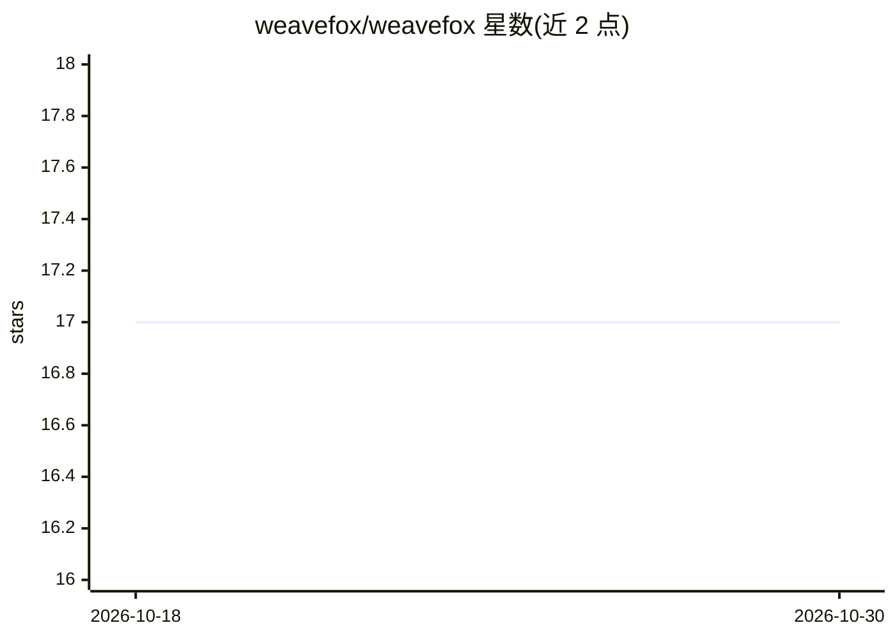

# weavefox/weavefox

⭐ 17 · MIT · 推送 2026-08-21 · [GitHub](https://github.com/weavefox/weavefox) · [官网](https://www.weavefox.cn) · 组织维护 · 中文 README

**AI 辅助创意变现应用（README 信息极少）**

WeaveFox 自称定位为『灵感即产品，让创意快速变现；零门槛做应用』，主题标签含 ai、creative、vibe-coding，指向面向非开发者的 AI 应用生成/创意落地工具。但 README 主体仅含双语标语、徽章与 9 张截图占位，未提供功能说明、安装方式或使用机制等可验证内容，无法进一步核验其具体能力与限制。

## 筛选速览

| 维度 | 判定 | 备注 |
|---|---|---|
| AI 角色 | `ai-native` | 本体是模型或模型工具 |
| 许可风险 | `permissive` | MIT |
| 部署形态 | `None` |  |
| 模型依赖 | — | README 未给出锁定关系 |
| 硬件要求 | — | 无带数字的原话,不猜 |
| 安装摩擦 | `low` | 无编译、无系统依赖或容器化 |
| 成熟度 | — | 结构信号不足 |

## 能力要点

- README 仅含双语标语与截图，未描述具体功能
- 主题标签含 ai、creative、vibe-coding

## 适用场景

- 无法从 README 确认具体适用场景

## 场景标签

 · 领域:AI 应用生成/创意工具

## 证据(README 行号)

> L6:  🦊「你的创意，值得让全世界看到」Weave creativity with AI, and let AI serve humanity.

## 星数曲线

2026-10-18 17 → 2026-10-30 17（+0）

---
*卡片 v1 · prompt 1.4 · 生成 2026-10-29 · 置信度 low · 依据 README sha `64923ad5dea6` · [字段定义](../../DATASET.md)*
