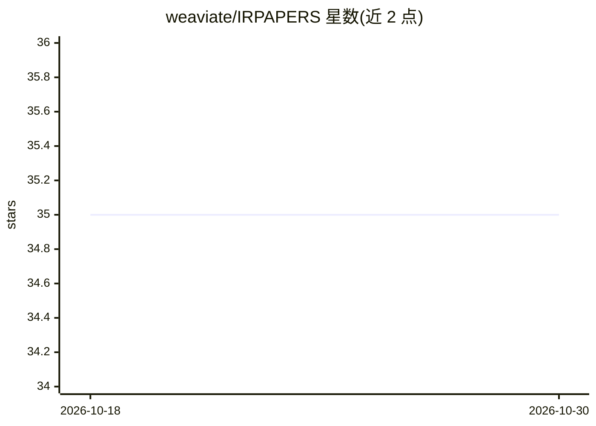

# weaviate/IRPAPERS

⭐ 35 · Jupyter Notebook · MIT · 推送 2026-09-30 · [GitHub](https://github.com/weaviate/IRPAPERS) · [官网](https://arxiv.org/pdf/2602.17687) · 组织维护

**科学文献视觉检索与问答基准数据集，附双榜单**

面向科学文档的视觉检索与问答基准：数据集发布于 HuggingFace，配套论文与实验代码。README 提供检索榜单（18 个检索器，含 Mixedbread、Voyage、Cohere Embed、ColQwen2、ColPali、BM25 等，按 Recall@1/5/20 排序）与问答榜单（9 个系统，含 TextRAG/ImageRAG/Oracle 检索基线，按 Alignment Score 与输入输出 token 统计）。由 Weaviate 团队成员署名维护，供评测与研究使用。

## 筛选速览

| 维度 | 判定 | 备注 |
|---|---|---|
| AI 角色 | `ai-knowledge` | 知识聚合/清单类 |
| 许可风险 | `permissive` | MIT |
| 部署形态 | `None` |  |
| 模型依赖 | — | README 未给出锁定关系 |
| 硬件要求 | — | 无带数字的原话,不猜 |
| 安装摩擦 | `low` | 无编译、无系统依赖或容器化 |
| 成熟度 | — | 结构信号不足 |

## 能力要点

- 科学文档视觉检索与问答双基准榜单
- 检索榜覆盖 18 种文本/图像/混合检索器
- 问答榜含 TextRAG/ImageRAG 与硬负例、无检索基线对比
- 数据集托管于 HuggingFace，实验代码另行开源

## 适用场景

- 评测视觉文档检索器在科学文献上的召回表现
- 对比 RAG 系统在科学问答任务上的表现
- 获取科学文档检索/问答研究基准数据

## 场景标签

`模型评测` · 领域:评测与运维

## 证据(README 行号)

> L1: # IRPAPERS
> L2: A Visual Document Benchmark for Scientific Retrieval and Question Answering.
> L4: - You can also find the dataset on HuggingFace.

## 星数曲线

2026-10-18 35 → 2026-10-30 35（+0）

---
*卡片 v1 · prompt 1.4 · 生成 2026-10-25 · 置信度 high · 依据 README sha `8f8145e12be5` · [字段定义](../../DATASET.md)*
